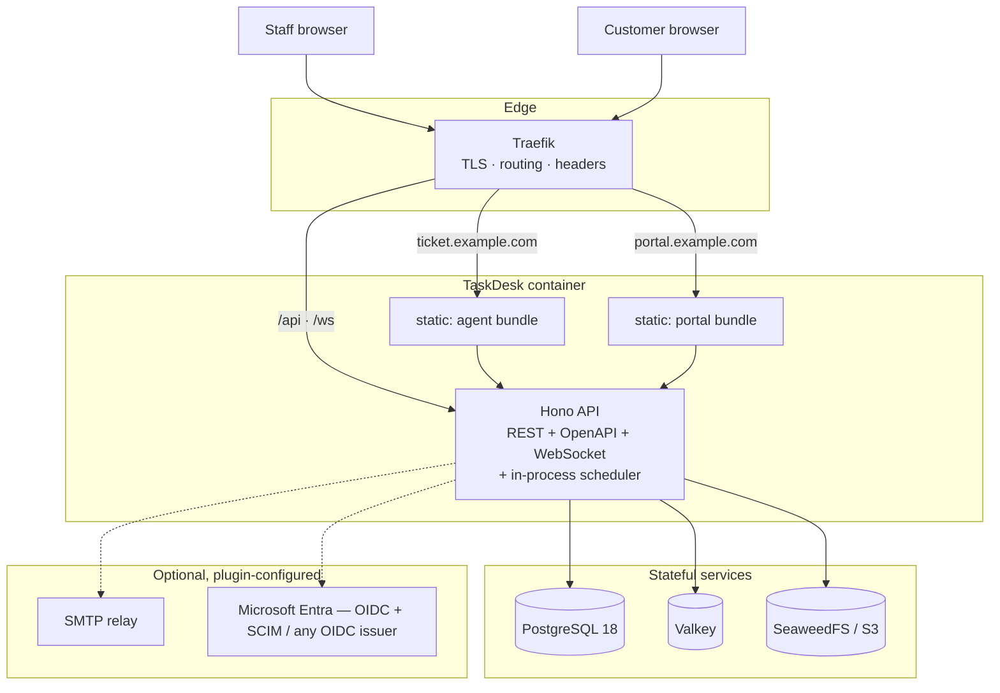

# Architecture and experience contracts

Maintained product architecture, original Kaneo experience, extension/runtime configuration, accessibility, quality budgets and documentation requirements. These references preserve intended behavior; target folders, snapshot counts, implementation descriptions and dependency versions are not an assertion about current code or acceptance. Current [AGENTS](../../AGENTS.md), [owner alignment](../alignment.md) and [integration contracts](../contracts.md) take precedence. Keep real API/tenant/permission safeguards and one shipping application image.

- [Architecture and request lifecycle](#overview) · [Package boundaries](#monorepo-layout)
- [Inherited Kaneo features and attribution](#inherited-features) · [Stack choices](#tech-stack)
- [Runtime plugins, flags and branding](#plugin-architecture) · [Internationalisation](#i18n)
- [Original composition and motion](#design-principles) · [Navigation and URLs](#information-architecture)
- [Accessibility and supported verification matrix](#accessibility) · [G1–G14 and fixed performance budgets](#ux-quality-gates)
- [Public documentation product](#plan) · [Writing and documentation coverage](#content-style-guide)
- [Source conflicts and pending references](#source-conflicts)

## Existing maintained contracts

[Features](features.md) owns the live flag vocabulary/defaults; [workspace boundaries](workspace-boundaries.md), [UI boundaries](ui-boundaries.md), [schema](data-model.md), [configuration](configuration.md), [jobs](background-jobs.md), [events](events.md) and [permissions](permissions.md) retain their exact tables. [Roadmap](../roadmap.md) owns phase order. Source fragments linked as pending below still require a maintained clause; no archive file is needed to read this reference, and no pending clause is silently treated as satisfied.

<a id="overview"></a>
## Architecture overview

<a id="overview-shape"></a>
### Shape

One backend. One frontend codebase producing two bundles. Everything else is a
supporting service.



<a id="overview-why-one-backend"></a>
### Why one backend

v1 ran a .NET core-api, a Node BFF and a Go worker. Three languages, three deploy
artefacts, three dependency trees, three sets of auth plumbing between them — and the
BFF existed only to hold session secrets and aggregate views.

In v2:

- **The BFF disappears.** Hono *is* the backend-for-frontend. It holds the session, calls
  the database directly, and shapes responses for the UI.
- **The worker disappears.** kaneo's API already carries `croner` for scheduling and a
  `job_lease` table for distributed locking. SLA scanning, reminders, snapshot
  computation and webhook delivery become in-process scheduled jobs that are safe to run
  on multiple replicas.
- **One language.** TypeScript end to end, with types shared between server and client
  through the Hono client in `packages/libs`.

Full reasoning: [ADR 0002](design-and-decisions.md#0002-single-backend).

<a id="overview-layers"></a>
### Layers

```
┌────────────────────────────────────────────────────────────┐
│ apps/web — React 19, TanStack Router + Query, Tailwind v4  │
│   entry.agent.tsx          entry.portal.tsx                │
│   route tree: /agent/*     route tree: /portal/*           │
│                    ↓ both import ↓                         │
│              packages/ui  (the only primitives)            │
└────────────────────────────────────────────────────────────┘
                      ↕ typed Hono client (packages/libs)
┌────────────────────────────────────────────────────────────┐
│ apps/api — Hono                                             │
│  ┌──────────────────────────────────────────────────────┐  │
│  │ transport   routes · zod-openapi · WebSocket · cron   │  │
│  ├──────────────────────────────────────────────────────┤  │
│  │ policy      packages/permissions — every route gated  │  │
│  ├──────────────────────────────────────────────────────┤  │
│  │ domain      packages/domain — SLA, workflow,          │  │
│  │             approvals, assignment, calendars.         │  │
│  │             Pure functions. No I/O. Heavily tested.    │  │
│  ├──────────────────────────────────────────────────────┤  │
│  │ plugins     auth · storage · notify · import          │  │
│  │             registries, configured at runtime          │  │
│  ├──────────────────────────────────────────────────────┤  │
│  │ data        Drizzle ORM → PostgreSQL                   │  │
│  └──────────────────────────────────────────────────────┘  │
└────────────────────────────────────────────────────────────┘
```

**The domain layer is the point.** SLA calculation, workflow transition legality,
approval gating and assignment rules are pure functions over plain data. They do no I/O,
so they are trivially unit-testable — which matters, because they encode the rules the
business actually cares about and they are where v1's real value lived.

<a id="overview-request-lifecycle"></a>
### Request lifecycle

1. Traefik terminates TLS, applies security headers, routes by hostname.
2. Hono resolves the session cookie → `userId`.
3. **Portal boundary check** — a customer session on the agent origin is rejected outright.
4. **Identity resolution** — `userId` → directory record → side, organisation,
   memberships. *Never* read from token claims. See [RBAC](permissions.md).
5. **Policy check** — the route's declared capability is evaluated against the resolved
   reach and authority. Out of reach ⇒ `404`. In reach, insufficient authority ⇒ `403`.
6. Handler validates input with Zod, calls domain functions, persists via Drizzle.
7. **In the same transaction** as the change: the `activity` row, the `audit_log` row
   where the action is security-relevant, and the `outbox` row carrying the domain event
   ([events.md](events.md)).
8. **After commit**, from the commit hook — never from the handler body: WebSocket
   broadcast and in-app notification. Webhooks and email drain from the outbox. A rollback
   therefore never produces a phantom update.
9. Response, shaped by an explicit response schema. No ORM entities leak to the wire.

<a id="overview-realtime"></a>
### Realtime

WebSockets at `/ws`, using kaneo's adapter pattern: in-memory for single-instance,
Valkey pub/sub for multi-instance. Clients subscribe per project and per user. Every
mutation broadcasts, so two people on the same board see each other's changes.

Detail: [Realtime](safety-and-runtime.md#realtime).

<a id="overview-background-work"></a>
### Background work

In-process, `croner`-scheduled, guarded by the `job_lease` table so only one replica runs
a given job.

The job list — names, cadences, lease TTLs — lives in exactly one place:
[Background jobs](background-jobs.md). Job names are identifiers (`job_lease.name`,
Prometheus labels) and are deliberately not restated here.

<a id="overview-data"></a>
### Data

PostgreSQL 18 only. No secondary datastore for primary data.

- **Valkey** is a cache and a pub/sub bus. Losing it degrades performance, never data.
- **SeaweedFS/S3** holds attachment bytes; metadata stays in Postgres.
- Migrations are Drizzle-generated SQL, forward-only, applied at boot.

Detail: [Data model](data-model.md).

<a id="overview-two-portals-two-origins-one-codebase"></a>
### Two portals, two origins, one codebase

`ticket.<domain>` serves the agent bundle; `portal.<domain>` serves the customer bundle.
Separate cookies, separate route trees, separate identity provider bindings — but **one
`apps/web` source tree and one shared `packages/ui`**.

This preserves v1's information-disclosure benefit (internal route names, admin labels
and staff feature names never ship to a customer browser) without v1's mistake of
maintaining two divergent UI codebases.

The bundle split is **not** the security boundary. The security boundary is server-side
policy. See [Security model](safety-and-runtime.md#security-model) and
[ADR 0004](design-and-decisions.md#0004-two-portals-two-origins).

<a id="overview-everything-pluggable"></a>
### Everything pluggable

No customer-specific code paths. Identity providers, storage backends, notification
channels, importers and feature toggles are all runtime configuration edited in God Mode.
One image, any customer.

Detail: [Plugin architecture](#plugin-architecture).

<a id="overview-what-we-deliberately-do-not-do"></a>
### What we deliberately do not do

| Not doing | Why |
| --- | --- |
| Microservices | One backend is enough at our scale; v1 proved the cost |
| GraphQL | REST + OpenAPI + a typed client already gives end-to-end types |
| Event sourcing | Audit journal gives point-in-time reconstruction without the complexity |
| Separate admin SPA | God Mode is a capability-gated route group in the agent app |
| Kubernetes as the primary target | Docker Compose behind Traefik is the supported path; a Helm chart exists but is secondary |
| Offline / local-first | Out of scope |

<a id="overview-related"></a>
### Related

- [Tech stack](#tech-stack) · [Monorepo layout](#monorepo-layout)
- [Auth and identity](safety-and-runtime.md#auth-and-identity) · [RBAC](permissions.md) · [Multi-tenancy](safety-and-runtime.md#multi-tenancy)
- [ADR index](design-and-decisions.md#README)

<a id="i18n"></a>
## Internationalisation

The layer [ADR 0012](design-and-decisions.md#0012-terminology-overlay) builds on, which no document
previously described. Written 2026-09-05.

<a id="i18n-inherited-from-kaneo"></a>
### Inherited from kaneo

- **i18next** + `react-i18next`, resources under `i18n/<locale>.json`, loaded per locale
  with `i18next-resources-to-backend`; a `schema.json` and `scripts/i18n/check.mjs` that
  fails CI when a key is missing from `en-US`.
- **18 locale files** at the local clone, **19 at upstream `42bb8011`** (pl-PL landed after) — the
  count is stated for the SHA actually taken, in [inherited-features.md](#inherited-features) (`de-DE, el-GR, en-US, es-ES, fr-FR, hi-IN, id-ID, it-IT,
  ja-JP, ko-KR, mk-MK, nl-NL, pt-BR, ru-RU, tr-TR, uk-UA, vi-VN, zh-CN`) — not 22, as an
  earlier draft said. `en-US` is authoritative.
- ICU-style interpolation and i18next's CLDR plural handling (`_one`, `_other`, `_few`,
  `_many`, …).
- **Location:** the root `i18n/` directory, `scripts/i18n/*.mjs` and the CI `i18n` job are
  kept exactly where kaneo has them — not moved to `packages/i18n/` (decision log 2026-09-06).

<a id="i18n-what-v2-adds"></a>
### What v2 adds

| Concern | Rule |
| --- | --- |
| Terminology overlay | Only keys in the `term:*` namespace are overridable. Their source strings are authored with `{{term_workItem}}`-style interpolation, so a noun changes in one place. Overrides ship for `en-US` at P0; every other locale falls back to its shipped translation until an administrator supplies that locale's forms ([ADR 0012](design-and-decisions.md#0012-terminology-overlay), `GM-T1`–`GM-T6`) |
| Plural forms | `terminology_override.forms jsonb` keyed by CLDR category; the editor shows the categories the locale has. A `singular`/`plural` pair cannot express ru/uk/pl (3–4 forms) or ar (6) |
| Delivery | `GET /api/public/terminology?locale=` with an ETag, invalidated on save; the client merges it above the shipped bundle. `packages/email` resolves at send time |
| Accessible names | The visible label **is** the accessible name under an override; the default noun goes in `title`, never `aria-label` ([accessibility.md](#accessibility)) |
| Dates, numbers, currency | `Intl.*` via `@internationalized/date` and `date-fns`, in the person's `locale` and `timezone` from `user_preference` |
| Full-text search | `'english'` stemming for all content — a stated limitation; a per-workspace regconfig is a later decision ([data model](data-model.md)) |
| RTL | **Not in P0–P4.** `he`/`ar` are not in the inherited set; RTL layout is a candidate ([roadmap.md](../roadmap.md)) and is stated here so it is not assumed |
| Gate | `check:i18n` — `en-US` complete; `term:*` keys interpolate; no hard-coded product nouns outside `term:*` (a lint rule) |

<a id="i18n-namespace-groups-on-the-work-list-g11"></a>
### Namespace groups on the work list (G11)

A direct visit to the work-list route (`/agent/projects/<key>/work`) is the G11 LCP path, and
the whole `en-US` catalog was about 31 KB gzip of it. That route therefore loads a **first-paint
group** of namespaces before it paints and the **deferred group** (every other namespace) after
first contentful paint. Every other entry point (sign-in, the portal, a direct visit to any other
screen) still loads the full locale before it renders.

| Part | Where | Rule |
| --- | --- | --- |
| Groups | `apps/web/vite/i18n-namespace-groups.ts` | A Vite plugin serves each `i18n/<locale>.json` as two virtual modules, `slim-<locale>` and `rest-<locale>`, plus a loader table per group. The catalog files stay the single source: `check:i18n` and the translation workflow are unchanged. The portal build gets empty loader tables (no group chunks). |
| First-paint list | `apps/web/src/lib/i18n/work-route-namespaces.ts` (`WORK_ROUTE_I18N_NAMESPACES`) | Currently `common`, `navigation`, `workItems`. |
| Runtime | `apps/web/src/lib/i18n/index.ts` | Group mode is chosen once at load from the URL. Init loads the first-paint group; `preloadNamespaces` loads the deferred group after first contentful paint and an idle moment (`after-first-paint.ts`). `bindI18nStore: "added"` re-renders components when a namespace lands. |
| Root-route wait | `apps/web/src/routes/agent/__root.tsx` | `beforeLoad` awaits `whenAllNamespacesLoaded()` for every path except the work list, so no other screen can render before the full catalog is there. Components reference namespaces other than `common` through `t("ns:key")` and i18next does not load those on demand, so this wait is what prevents raw keys. |
| Failure | `ensureAllNamespaces` | Deferred group, one retry, then the full locale chunk (a different file). If all three fail the root error screen shows; a screen never renders raw keys because a fetch failed. |
| Guard | `vite.config.ts`, `findDeferredNamespaceUsers` | The build fails if any source module in the work route's first-paint chunks (entry, shell routes, the route, its panel and their on-demand chunks) refers to a namespace outside the first-paint group (`"ns:key"` strings, `useTranslation("ns")` / `[...]`, `{ ns }` options), unless it is on `DEFERRED_NAMESPACE_ALLOWLIST` with a reason. |

**Adding a namespace.** Add it to every locale file as usual (`pnpm i18n:check:fix`, `pnpm
i18n:schema`). It is deferred by default and nothing else is needed for a screen that is reached
by navigation. If a component that paints on the work list needs it, the build guard fails:
either add the namespace to `WORK_ROUTE_I18N_NAMESPACES` (costs bytes on the LCP path; re-run
the G11 LCP A/B and `check:bundle-size`) or, if the strings cannot be visible before the
deferred group lands, add the module to `DEFERRED_NAMESPACE_ALLOWLIST` with the reason. The
e2e spec `work-list-i18n-deferred.spec.ts` holds and fails the deferred chunk and asserts no
element shows a catalogue key.

<a id="i18n-related"></a>
### Related

- [ADR 0012](design-and-decisions.md#0012-terminology-overlay) · [God Mode](feature-contracts-p4.md#god-mode) · [Accessibility](#accessibility)

<a id="inherited-features"></a>
## Inherited-features register

Kaneo product mechanisms and dependencies have explicit keep/remove/replace dispositions. A keep-with-spec feature remains flagged off until aligned, except current Thomas decisions explicitly restoring existing Calendar/Gantt in P1. Source line numbers and counts identify the original snapshot, not current files.

<a id="inherited-features-snapshot-provenance-and-current-evidence-boundary"></a>
### Snapshot provenance and current evidence boundary

The attribution baseline is Kaneo `42bb801114aa1ae499228a53180f0cdbc5607964`, confirmed by Thomas on 6 September 2026. Keep its MIT attribution in `THIRD-PARTY-NOTICES.md` while TaskDesk's own source remains AGPL-3.0. Snapshot-era counts, toolchain facts, test passes and advisory reachability are historical evidence, never today's acceptance or scan results. Preserve inherited suites for attribution; run current laptop tests and scans against the actual shipping source/image.

<a id="inherited-features-environment-migration-record--the-complete-inherited-surface"></a>
#### Environment migration record — the complete inherited surface

`grep process.env` is **not** sufficient, and this is the reason the earlier count was wrong.
kaneo reads environment variables three ways, and only the first is greppable:

| How | Where | Hidden variables |
| --- | --- | --- |
| `process.env.NAME` | everywhere | 95 |
| `process.env[name]` through a local helper | `apps/api/src/storage/s3.ts:79-81` — `function env(name) { return process.env[name]?.trim() \|\| "" }` | the **seven S3 connection variables** |
| `process.env[TABLE[k][j]]` through a lookup | `apps/api/src/billing/config.ts:55,63` — `PRODUCT_ENV_KEYS` | four `CREEM_PRODUCT_*` |
| parameter default `env: SmtpEnv = process.env` | `packages/email/src/smtp-config.ts:15,39` | the eight `SMTP_*` |

**The real total is 98 variables**, not the "~80" the planning documents quote. Any
`check:env` gate must resolve indirect reads or it will pass a tree that still reads
unapproved configuration.

<a id="inherited-features-bootstrap-variable-disposition"></a>
##### Bootstrap-variable disposition

| kaneo | TaskDesk | Note |
| --- | --- | --- |
| `AUTH_SECRET` | `TASKDESK_AUTH_SECRET` | one of the five required |
| `DATABASE_URL` | `TASKDESK_DATABASE_URL` | one of the five required |
| `KANEO_CLIENT_URL` | `TASKDESK_AGENT_URL` | one of the five required |
| `NOTIFICATION_SECRET_ENCRYPTION_KEY` | `TASKDESK_ENCRYPTION_KEY` | one of the five required; kaneo already had a secret-encryption key, so this is a rename, not a new mechanism |
| `REDIS_URL` | `TASKDESK_VALKEY_URL` | optional operational |
| `KANEO_API_URL`, `KANEO_API_KEY` **in `packages/mcp` only** | `TASKDESK_API_URL`, `TASKDESK_API_KEY` | the **MCP client's own** configuration on the user's machine — `configuration-reference.md` is explicit that the server never reads either |

`TASKDESK_PORTAL_URL` — the fifth required variable — is **new**: kaneo has one origin, so
there is nothing to rename. It is introduced with the second entry point in #9/#11.

<a id="inherited-features-moved-to-runtime-configuration--god-mode-not-environment"></a>
##### Moved to runtime configuration — God Mode, not environment

Per the storage decision of 2026-09-06 and the "nothing is hardcoded per customer" rule.
**Non-secret** values become plugin or instance configuration rows; **credentials** go
through TaskDesk's secret storage and are encrypted with `TASKDESK_ENCRYPTION_KEY`, never
held as plaintext configuration.

| Group | Variables | Destination | Secret? |
| --- | --- | --- | --- |
| **S3 connection** | `S3_ENDPOINT`, `S3_BUCKET`, `S3_REGION`, `S3_PUBLIC_BASE_URL`, `S3_KEY_PREFIX` | `storage.s3` plugin config | no |
| **S3 credentials** | `S3_ACCESS_KEY_ID`, `S3_SECRET_ACCESS_KEY` | `storage.s3` plugin config | **yes — encrypted** |
| **S3 tuning** | `S3_FORCE_PATH_STYLE`, `S3_MAX_IMAGE_UPLOAD_BYTES`, `S3_PRESIGN_TTL_SECONDS` | `storage.s3` plugin config | no |
| **SMTP** | `SMTP_HOST`, `SMTP_PORT`, `SMTP_FROM`, `SMTP_SECURE`, `SMTP_REQUIRE_TLS`, `SMTP_IGNORE_TLS` | `notify.email` plugin config | no |
| **SMTP credentials** | `SMTP_USER`, `SMTP_PASSWORD` | `notify.email` plugin config | **yes — encrypted** |
| **Generic OIDC** | `CUSTOM_OAUTH_DISCOVERY_URL`, `CUSTOM_OAUTH_AUTHORIZATION_URL`, `CUSTOM_OAUTH_TOKEN_URL`, `CUSTOM_OAUTH_USER_INFO_URL`, `CUSTOM_OAUTH_LOGOUT_URL`, `CUSTOM_OAUTH_SCOPES`, `CUSTOM_OAUTH_RESPONSE_TYPE`, `CUSTOM_OAUTH_AUTO_LOGIN`, `CUSTOM_AUTH_PKCE`, `CUSTOM_OAUTH_CLIENT_ID` | `identity_connection` | no |
| **OIDC secret** | `CUSTOM_OAUTH_CLIENT_SECRET` | `identity_connection` | **yes — encrypted** |
| **Social providers** | `GOOGLE_CLIENT_ID`, `GOOGLE_CLIENT_SECRET` | `identity_connection` | secret half **encrypted** |
| **Instance switches** | `DISABLE_REGISTRATION`, `DISABLE_LOGIN_FORM`, `DISABLE_PASSWORD_REGISTRATION`, `DISABLE_EMAIL_OTP_SIGN_IN`, `DISABLE_WORKSPACE_CREATION` | instance settings | no |
| **Origins / cookies** | `CORS_ORIGINS`, `COOKIE_DOMAIN` | derived from `TASKDESK_AGENT_URL` + `TASKDESK_PORTAL_URL`, or instance settings | no |
| **Valkey topology** | `REDIS_CLUSTER_NODES`, `REDIS_SENTINELS`, `REDIS_SENTINEL_MASTER_NAME`, `REDIS_SENTINEL_TLS` | operational; fold into `TASKDESK_VALKEY_URL` or an operational row | no |
| **Valkey credentials** | `REDIS_PASSWORD`, `REDIS_SENTINEL_PASSWORD` | as above | **yes** |
| **Postgres parts** | `POSTGRES_HOST`, `POSTGRES_PORT`, `POSTGRES_DB`, `POSTGRES_USER`, `POSTGRES_PASSWORD` | kaneo derives a URL from these when `TASKDESK_DATABASE_URL` is absent (`apps/api/src/database/resolve-database-url.ts`). TaskDesk has **one** required URL, so this derivation path is redundant and is removed with the configuration work | **yes** (password) |

<a id="inherited-features-variables-removed-with-their-features"></a>
##### Variables removed with their features

| Group | Variables | Deleted with |
| --- | --- | --- |
| Billing | `CREEM_API_KEY`, `CREEM_WEBHOOK_SECRET`, `CREEM_TEST_MODE`, `CREEM_PRODUCT_PERSONAL_MONTHLY`, `CREEM_PRODUCT_PERSONAL_ANNUAL`, `CREEM_PRODUCT_TEAM_MONTHLY`, `CREEM_PRODUCT_TEAM_ANNUAL`, `BILLING_TRIAL_DAYS`, `BILLING_FOUNDING_CUTOFF`, `BILLING_REMINDER_MAX_PER_RUN` | the billing system. kaneo's provider is **Creem**, not Stripe |
| Sentry | `SENTRY_DSN`, `SENTRY_ENVIRONMENT`, `SENTRY_RELEASE`, `SENTRY_TRACES_SAMPLE_RATE`, `SENTRY_PROFILES_SAMPLE_RATE`, `SENTRY_AUTH_TOKEN`, `SENTRY_ORG`, `SENTRY_PROJECT` | Sentry. **This settles the contradiction** between §2 of `repository-bootstrap.md` (which said *Move* for the first five) and §3 item 10 (*delete every `SENTRY_*`*): Sentry is deleted. `SENTRY_AUTH_TOKEN` is a live CI credential and must not be inherited |
| GitHub integration | `GITHUB_APP_ID`, `GITHUB_APP_NAME`, `GITHUB_CLIENT_ID`, `GITHUB_CLIENT_SECRET`, `GITHUB_OAUTH_CLIENT_ID`, `GITHUB_OAUTH_CLIENT_SECRET`, `GITHUB_PRIVATE_KEY`, `GITHUB_PRIVATE_KEY_BASE64`, `GITHUB_WEBHOOK_SECRET` | the GitHub integration router |
| Discord integration | `DISCORD_CLIENT_ID`, `DISCORD_CLIENT_SECRET` | the Discord integration router |
| Generic webhook | `KANEO_ALLOW_PRIVATE_WEBHOOK_DESTINATIONS` | the generic webhook router. **This settles its contradiction too** — §2 said *Move*, §3 item 8 said removed; it goes with the router |
| Anonymous sign-in | `DISABLE_GUEST_ACCESS` | the `anonymous()` plugin |
| Device authorization | `DEVICE_AUTH_CLIENT_IDS` | the `deviceAuthorization` plugin |
| MCP OAuth | `KANEO_MCP_CLIENT_ID` | the MCP OAuth routes |
| Cloud-only | `KANEO_CLOUD`, `DEMO_MODE` | cloud/SaaS behaviour. **Note:** `KANEO_CLOUD` currently gates `rateLimit.enabled` — deleting it must **enable** abuse protection, never freeze it off. See the security row below |

<a id="inherited-features-kept--operating-system-variables-not-configuration"></a>
##### Kept — operating-system variables, not configuration

`NODE_ENV`, `APPDATA`, `XDG_CONFIG_HOME` (the last two are the MCP client resolving a
config directory on the user's own machine).

<a id="inherited-features-configuration-decisions-requiring-explicit-resolution"></a>
##### Configuration decisions requiring explicit resolution

| Variable | Deferred to | Why |
| --- | --- | --- |
| `TRUSTED_PROXIES` → `TASKDESK_TRUST_PROXY` | **#11** | This is **not a rename**. kaneo takes a comma-separated CIDR **list**, defaulting to all of RFC1918 — so on a shared cluster every pod can forge the header the rate limiter keys on. TaskDesk takes a **hop count**. Changing list semantics to hop-count semantics is a behaviour change on a security boundary, and the correct hop count for this deployment must be **measured** from the headers actually arriving, not inferred from the topology diagram |
| `KANEO_API_URL`, `KANEO_INTERNAL_API_URL` | **#11** | Both describe the API's own origin. Under TaskDesk's single-image model the web bundle is same-origin by construction, so these do not simply rename — they may disappear. That resolution belongs with the container-image work |
| `TURNSTILE_SECRET_KEY`, `TURNSTILE_TIMEOUT_MS` | **Thomas** | Cloudflare Turnstile is inherited CAPTCHA abuse protection. TaskDesk requires abuse protection for self-hosted deployments, but a Cloudflare dependency is not obviously the right shape for a self-hosted product, and it is not in the plugin registry. This is the one variable group the storage/plugin rule does not cleanly classify, so it is raised rather than decided |


**Primitive libraries found in `components/ui`:** **Base UI 43 / Radix 1 of 63** files
(`form.tsx` imports `@radix-ui` `Slot`; `timeline.tsx` imports `Slot` from the `radix-ui`
umbrella). **17 of the 18 `@radix-ui/*` dependencies in `apps/web/package.json` are unused
and are pruned** — see [ui-extraction-plan.md](ui-boundaries.md#retained-extraction-and-interaction-constraints).

| kaneo feature / dependency | Where | Verdict | v2 spec / flag |
| --- | --- | --- | --- |
| `github-integration`, `gitea-integration` (`octokit`, `@octokit/webhooks`) | `apps/api/src` | **Remove at fork** (decided 2026-09-05) | Routers, handlers, screens and dependencies deleted — not kept dormant. `external_link` and the reserved `devlink` kind are the extension point; future priority GitHub → GitLab → Gitea → Bitbucket → Azure DevOps ([plugin-architecture.md](#plugin-architecture)). `feature.dev_links` reserved, no code |
| `slack-integration`, `discord-integration`, `telegram-integration` | `apps/api/src` | **Remove at fork** (decided 2026-09-05) | Deleted, not flagged. They return — if at all — as `notify.*` plugins in the order Teams → Slack → Telegram → Viber, outside the current scope |
| `generic-webhook-integration` | `apps/api/src` | **Replace** | Deleted; our signed outbound webhooks ([webhooks-and-api-keys.md](feature-contracts-p4.md#webhooks-and-api-keys)) are written fresh in P4 with `WH-1`…`WH-14` |
| `plugins/` — the registry | `apps/api/src/plugins` | **Split** | `plugins/index.ts` registers exactly the six integrations above, so it goes with them; the six subdirectories are deleted along with the `integration` (`schema.ts:867`) and `github_integration` (`schema.ts:845`) tables and their tests under `tests/api/plugins/`. **`registry.ts` and `types.ts` are kept** as the seed of `packages/plugins-contracts` ([plugin-architecture.md](#plugin-architecture)) |
| `workflow-rule` | `apps/api/src` | Keep | [automations.md](feature-contracts-p4.md#automations); `feature.automations` off until aligned |
| `time-entry` | `apps/api/src` | Keep | [time-and-cost.md](feature-contracts-p5.md#time-and-cost); `feature.time_tracking` |
| `public-project` (anonymous public boards) | api + web | **Remove at fork** (decided 2026-09-05 — a flag is a runtime toggle, not a deletion; an unauthenticated read surface does not ship dormant) | Not a router — a checklist: the inline route at `apps/api/src/index.ts:226`; `project/schema.ts`; `project/response.ts`; `project/controllers/update-project.ts`; `mcp/tools.ts`; **`utils/authorize-asset-access.ts:23` — the anonymous attachment-read branch**; web `components/public-project/`, `routes/public-project.$projectId.tsx`, its fetchers, hooks and four tests; and a **two-phase drop** of `project.is_public` (`database/schema.ts:328`) per [migrations.md](design-and-decisions.md#migrations). The flag name `feature.public_boards` stays **reserved** for a future spec'd re-implementation with its own security review |
| `GET /invitation/public/:id` (`index.ts:240`) | `apps/api/src` | **Keep**, as policy kind 4 (`public`) | The only other unauthenticated route in kaneo's `index.ts`. Rate-limited in the anonymous class, constant-shape 404 for an unknown or expired id, no email address and no member list. The invitee has to see what they are accepting; the id is a ≥128-bit token ([rbac.md](permissions.md)) |
| better-auth `anonymous()` guest sign-in + `DEMO_MODE` | `apps/api/src/auth.ts:278`, `utils/get-settings.ts` | **Remove at fork** | Enabled by default upstream (opt-**out** via `DISABLE_GUEST_ACCESS`), with `hasGuestAccess` / `isDemoMode` shipped to the client and anonymous users exempted from the registration limits. Same reasoning as public boards. The `emailDomainName: "kaneo.app"` literal goes with it. `no-anonymous-plugin.test.ts` reads the constructed config |
| better-auth `deviceAuthorization()` and `bearer()` | `auth.ts:545`, `:535` | **Remove at fork** | Two authentication surfaces no v2 spec mentions; `DEVICE_AUTH_CLIENT_IDS` and `tests/api-integration/device-authorization.test.ts` go with them. Either returns only with a spec and a security review |
| better-auth `organization()` plugin | `auth.ts:315` | **Remove at fork** — replaced | It *is* kaneo's workspace model. Its `/organization/*` routes are unmounted and gone; TaskDesk's `invitation`, `workspace_role` and team tables replace it ([data-model.md](data-model.md), [multi-tenancy.md](safety-and-runtime.md#multi-tenancy)) |
| better-auth `adminPlugin()` | `auth.ts:550` | **Keep as a session primitive only** | The impersonation and user-state primitives are used; its HTTP routes are **not mounted**. Elevation is TaskDesk's own ([rbac.md](permissions.md), [god-mode.md](feature-contracts-p4.md#god-mode)) |
| better-auth `accountLinking` | `auth.ts:235-245` | **Disable explicitly** | Ships `enabled: true` with `trustedProviders: ["github","google","discord","custom"]` — and `"custom"` is the `genericOAuth` provider `auth.oidc` is built on. Set `enabled: false`; `IP-18`'s test reads the constructed config ([auth-and-identity.md](safety-and-runtime.md#auth-and-identity)) |
| better-auth `session.cookieCache` | `auth.ts:557-560` | **Disable** | Five minutes upstream; a revoked session would stay live that long. Disabled at fork — see the revocation SLA in [auth-and-identity.md](safety-and-runtime.md#auth-and-identity) § Sessions |
| better-auth `twoFactor()` | not enabled upstream | **Add in P0** | kaneo enables neither `twoFactor` nor `passkey`; TaskDesk adds `twoFactor` ([auth-and-identity.md](safety-and-runtime.md#auth-and-identity)) |
| `gantt`, `calendar` views | `apps/web` | Keep | [views.md](feature-contracts-p1.md#views); `feature.timeline`, `feature.calendar` until P5 UX gates pass |
| `backlog-list-view`, `kanban-board`, `list-view`, `bulk-selection`, `command-palette`, `keyboard-shortcuts-help`, `search`, `onboarding`, `profile-setup`, `team` | `apps/web` | Keep | Covered by P1 specs |
| `scheduler` (`croner`), `invitation`, `notification-preferences`, `external-link`, `task-relation`, `column`, `activity`, `storage`, `instance` | `apps/api/src` | Keep | The mechanisms v2 assumes |
| `job_lease` table (`database/schema.ts:480` — `name`, `owner`, `expiresAt`) | `apps/api/src` | **Inherited — review and adopt** | It arrives with the snapshot (added post-`v2.22.0`); it is not ours to write. The heartbeat and the abort signal on lease loss are ours to add ([background-jobs.md](background-jobs.md)) |
| `mcp` and `oauth` routers | `apps/api/src` | **Remove at fork** | Two inherited surfaces with their own client credentials (`KANEO_API_KEY`, `KANEO_MCP_CLIENT_ID`) and their own OAuth store. TaskDesk's MCP server is specified separately ([mcp-server.md](feature-contracts-p4.md#mcp-server)) and is not this code; the four `tests/api/mcp-*.test.ts` and the two `mcp-oauth-*` integration tests go with them. `packages/mcp` is copied, minus its publish plumbing |
| `billing`, `trial-card`, `demo-alert`, `creem`, Turnstile / disposable-email checks | api + web | **Remove** (abuse checks → optional plugins) | **Four tables**: `workspace_billing` (`schema.ts:178`), `trial_grant` (`:211`), `billing_event` (`:217`), `billing_reminder_sent` (`:444`); plus `CREEM_*`, `BILLING_TRIAL_DAYS`, `BILLING_FOUNDING_CUTOFF`, `BILLING_REMINDER_MAX_PER_RUN`, `TURNSTILE_*`, `KANEO_CLOUD`, `get-settings.ts`'s `billingEnabled`, `tests/api/billing/` and the seven `tests/api-integration/billing-*` suites plus `trial-reminders`. [competitive-inspiration.md](../alignment.md#competitive-inspiration) |
| Sentry | api + web + `sentry/` | **Remove at fork** | The folder holds only `README.md`, `alerts.json`, `dashboards.json`; the real footprint is **17 code sites** — both `instrument.ts` files, `apps/web/vite.config.ts`'s source-map upload, the query client, the auth provider, the scheduler, `utils/authenticate-api-request.ts`, six files under `plugins/*` (which leave anyway) and **`components/ui/error-boundary.tsx`, which must be de-Sentry'd *before* it moves into `packages/ui`** — plus the `@sentry/*` dependencies and every `SENTRY_*` / `VITE_SENTRY_*` variable ([observability.md](safety-and-runtime.md#observability)) |
| `packages/planka-import` | packages | **Remove** | Park as `import.planka` only if trivially cheap; the `publish-planka-import` workflow goes with it |
| `valibot` | `apps/api` only | **Port one file** | Seven of its eight import sites are inside code being deleted (the six plugin `config.ts` files and the Telegram controller); the survivor is `apps/api/src/ws/redis-broadcast-adapter.ts`. Port that one to Zod after the deletions |
| `nanostores` | `apps/web` | **Not removable — keep** | Zero direct imports in `apps` or `packages`: it is better-auth's client store, which `useSession` is built on. It is not a Zustand alternative and is not on the consolidation list ([tech-stack.md](#tech-stack)) |
| `react-markdown`, `turndown`, `mermaid`, `shiki` (Markdown import/export, diagrams, code highlighting) | `apps/web` | Keep | Add to [comments-and-activity.md](feature-contracts-p1.md#comments-and-activity)'s rich-text rules |
| `@base-ui/react` + `@radix-ui/*` | `apps/web` | **Converge on Base UI** (decided 2026-09-05) | Already largely done upstream: 43 of 63 primitives are Base UI, 1 is Radix. The remaining work is that one file plus pruning 17 stale `@radix-ui/*` dependencies; `packages/ui/KNOWN-RADIX.md` will have about one row, with a revisit date, enforced by `check:ui`. Feature code imports only `@taskdesk/ui` — [ui-extraction-plan.md](ui-boundaries.md#retained-extraction-and-interaction-constraints) |
| `packages/permissions` | packages | **Replace, keep the role names** | 84 lines of better-auth `createAccessControl` and four static roles — no capability registry, no policy kinds, no evaluator, and a `better-auth` dependency that breaks the layout's "pure" rule. Roles `viewer`/`member`/`admin`/`owner` are kept for data continuity; the layer is written fresh ([monorepo-layout.md](#monorepo-layout), [rbac.md](permissions.md)) |
| `i18n/` — locale JSONs, `resources.ts`, `schema.json` | root | Keep, at the root | **18 locales at the local clone; 19 at upstream `42bb8011` (`pl-PL` added)** — state the count for the SHA actually taken. [i18n.md](#i18n) |
| `scripts/i18n/` (`check`, `report`, `schema`, `shared`) | root | Keep | The root `i18n:check` scripts and the CI i18n gate call them; they travel with the root `i18n/` |
| `tests/` (`tests/api`, `tests/api-integration`) | root | **Copy, minus the deleted areas** | kaneo's own suites are the attribution baseline. Deleted **in the same commit** as the code they cover: `tests/api/{billing,github-integration,gitea-integration,plugins/*}`, the four `mcp-*` unit tests, and `tests/api-integration/{billing-*,trial-reminders,device-authorization,mcp-oauth-*}` ([repository-bootstrap.md](retained-constraints.md#repository-bootstrap) §1) |
| `apps/site` (Next 16 marketing site) | apps | **Do not copy** | It is a marketing site, not a docs framework, and kaneo's documentation is `apps/docs` on Mintlify. TaskDesk plans a fresh headless Fumadocs site with Next.js static export; see [08-docs-site/plan.md](#plan). The planned site is not implemented and its dependencies are not installed. |
| `.github/` — templates, `dependabot.yml`, 15 workflows | root | **Do not copy — ours written fresh** | kaneo's `ci.yml` job list (lint, i18n, typecheck, unit, build, integration on `postgres:16`, docker-build) is read once as the shape ours starts from; `publish-mcp` and `publish-planka-import` have nothing to publish here ([ci-cd.md](ci-gates.md)) |

<a id="inherited-features-related"></a>
### Related

- [Licensing and provenance](../../THIRD-PARTY-NOTICES.md) · [Current agent rules](../../AGENTS.md)

<a id="monorepo-layout"></a>
## Monorepo layout

<a id="monorepo-layout-tree"></a>
### Tree

```
Ticketing.v2/
├── apps/
│   ├── api/                    Hono backend — the only backend
│   │   ├── drizzle/            generated SQL migrations, forward-only
│   │   └── src/
│   │       ├── index.ts        app bootstrap, static serving, health
│   │       ├── openapi.ts      createRoute helpers, spec assembly
│   │       ├── database/       schema.ts, client, seeds
│   │       ├── middleware/     session, portal boundary, identity, policy
│   │       ├── plugins/        auth/ storage/ notify/ import/ registries
│   │       ├── jobs/           croner definitions + job_lease helper
│   │       ├── ws/             websocket adapters (memory | valkey)
│   │       ├── events/         domain event bus and subscribers
│   │       └── <feature>/      one folder per feature — see below
│   ├── web/                    React frontend — one source, two bundles
│   │   ├── index.agent.html
│   │   ├── index.portal.html
│   │   └── src/
│   │       ├── entry.agent.tsx
│   │       ├── entry.portal.tsx
│   │       ├── routes/         TanStack Router file routes
│   │       │   ├── agent/
│   │       │   └── portal/
│   │       ├── components/     feature components (NOT primitives)
│   │       ├── fetchers/       typed API calls
│   │       ├── hooks/          queries/ mutations/ and plain hooks
│   │       ├── store/          zustand, UI state only
│   │       └── lib/            routes.ts registry, formatters, guards
│   └── site/                   planned self-hosted headless Fumadocs + Next static export; not implemented;
│                               fresh TaskDesk site, not copied from kaneo (08-docs-site/plan.md)
│
├── packages/
│   ├── ui/                     THE design system. Only source of primitives.
│   │   ├── src/components/     button, dialog, table, sidebar, … (63, extracted from apps/web)
│   │   ├── src/styles/         tokens.css, theme.css, motion.css
│   │   └── .storybook/
│   ├── domain/                 pure business logic, zero I/O
│   │   └── src/{sla,workflow,approvals,assignment,calendar,ranking}/
│   ├── permissions/            capabilities, roles, policy registry, evaluator
│   │                           REPLACES kaneo's 84-line package, keeping its four role names
│   ├── plugins-contracts/      the interfaces every plugin implements
│   ├── libs/                   typed Hono client, shared URL helpers
│   ├── email/                  React Email templates + sender
│   ├── mcp/                    MCP server (agent access + import tooling)
│   ├── importers/              azure-devops · plane · jira · csv
│   └── typescript-config/      shared tsconfig bases
│
├── tests/                      the first two directories are kaneo's own shape, inherited with its suites
│   ├── api/                    unit tests for API modules            (inherited, minus the deleted areas)
│   ├── api-integration/        Testcontainers + real Postgres        (inherited, minus the deleted areas)
│   ├── permissions/            role × route matrix, route coverage   (ours)
│   ├── e2e/                    Playwright — agent + portal projects  (ours)
│   └── visual/                 Playwright screenshot baselines       (ours)
│
├── charts/taskdesk/            Helm chart — derived from kaneo's, rewritten for one image (05-operations/kubernetes.md)
├── tests/fixtures/             seed datasets: minimal · realistic · hostile
├── deploy/                     compose files, Traefik config, env templates
├── scripts/                    deploy.sh · install.sh · backup.sh · restore.sh · archive-wal.sh · anonymise.ts (tested — tests/anonymise/)
│                               seed.ts · check-inventory.mjs · check-queries.mjs · i18n checks · openapi export
├── i18n/                       locale JSONs, resources.ts, schema.json — stays at the root, as kaneo has it
├── plans/                      motion & interaction design specs (from kaneo)
├── docs/                       this documentation corpus
├── .github/
│   └── workflows/              ours, written fresh — none of kaneo's fifteen are copied
├── AGENTS.md                   canonical guide for humans and AI agents — ours, never kaneo's
├── LICENSE                     AGPL-3.0
├── THIRD-PARTY-NOTICES.md      kaneo MIT notice and any other attributions
├── compose.yml                 local development stack
├── Dockerfile                  the single multi-stage image; kaneo's apps/api/Dockerfile and
│                               apps/web/Dockerfile are not copied (05-operations/container-image.md)
├── turbo.json  ·  biome.json  ·  pnpm-workspace.yaml
```

There is **no `apps/mcp`**: the MCP server lives in `packages/mcp` and is mounted by
`apps/api` ([mcp-server.md](feature-contracts-p4.md#mcp-server)). kaneo's inherited `mcp` and
`oauth` routers are a different thing and are removed at the fork
([inherited-features.md](#inherited-features)).

<a id="monorepo-layout-package-boundaries"></a>
### Package boundaries

The dependency graph is acyclic and enforced.

```
apps/web  ──► packages/ui, libs, permissions, domain   (locales come from the root i18n/)
apps/api  ──► packages/domain, permissions, plugins-contracts, email, libs, importers
packages/domain        ──► (nothing — pure)
packages/permissions   ──► (nothing — pure; kaneo's depends on better-auth, which is why it is
                            replaced rather than extended)
packages/plugins-contracts ──► (nothing — types only)
packages/ui            ──► (react, Base UI, tailwind, class-variance-authority, clsx,
                            tailwind-merge, lucide-react only — Radix only per
                            KNOWN-RADIX.md — plus, one primitive each: react-hook-form
                            (form.tsx), react-day-picker (calendar.tsx), input-otp
                            (input-otp.tsx); #9)
packages/typescript-config ──► (nothing — shared compiler configuration)
```

| Workspace | Permitted workspace edges |
| --- | --- |
| `@taskdesk/web` | `@taskdesk/ui`, `@taskdesk/libs`, `@taskdesk/permissions`, `@taskdesk/domain` |
| `@taskdesk/api` | `@taskdesk/domain`, `@taskdesk/permissions`, `@taskdesk/plugins-contracts`, `@taskdesk/email`, `@taskdesk/libs`, `@taskdesk/importers` |
| `@taskdesk/domain` | (none) |
| `@taskdesk/permissions` | (none) |
| `@taskdesk/plugins-contracts` | (none) |
| `@taskdesk/ui` | (none) |
| `@taskdesk/libs` | (none) |
| `@taskdesk/email` | (none) |
| `@taskdesk/mcp` | (none) |
| `@taskdesk/importers` | (none) |
| `@taskdesk/typescript-config` | (none) |

The arrows above are the complete permitted workspace-package edges. `check:deps` enforces
each arrow as a positive allowlist, checks the same graph for cycles, and resolves source
imports through TypeScript configuration, package import maps and workspace aliases before
checking their targets. Source under each workspace `src/` is parsed and scanned in full;
unparseable files and symbolic links fail the gate.

**Rules:**

- `packages/domain` may not import Drizzle, Hono, or anything with I/O. If a domain
  function needs data, the caller passes it in. This is what makes it testable.
- `packages/ui` may not import from `apps/*` or from any feature package. It knows
  nothing about work items.
- `apps/web` may not import from `apps/api` except through `packages/libs` types.
- `packages/libs` may import from `apps/api` only through top-level `import type` or
  `export type` declarations. Inline named `type` specifiers are treated as runtime edges
  by the boundary checker.
- No other package imports `apps/*`.

`pnpm check:deps` enforces this in CI.

<a id="monorepo-layout-api-feature-folder-convention"></a>
### API feature folder convention

Taken from kaneo unchanged. Every feature under `apps/api/src/` looks like:

```
work-item/
├── index.ts          route definitions: createRoute + policy + middleware
├── schema.ts         Zod schemas for params, query, body
├── response.ts       Zod schemas for responses — nothing else reaches the wire
├── policy.ts         the policy each route declares  (mandatory — one of the five kinds in rbac.md)
├── repository.ts     the ONLY place db.select()/insert()/update() on this feature's tables may appear;
│                     cross-organisation reads use scoped repository functions taking resolved identity
│                     (multi-tenancy.md; `forIdentity(identity)` is the accepted illustration/convention).
│                     Any additional workspace/project id is checked against that identity and applied
│                     in the statement predicate. No universal wrapper type is claimed; see coding-standards.md.
│                     check:queries is planned, not wired.
├── controllers/
│   ├── create-work-item.ts
│   ├── update-work-item.ts
│   └── …             one file per action
└── __tests__/
```

**`policy.ts` is mandatory.** A CI test enumerates the OpenAPI route table and fails if
any route has no policy entry. This is the mechanism that prevents v1's class of
authorization hole. See [Security model](safety-and-runtime.md#security-model).

<a id="monorepo-layout-frontend-component-convention"></a>
### Frontend component convention

```
apps/web/src/components/
├── board/            board-specific composites
├── work-item/        detail pane, field editors
├── settings/         settings forms
├── god-mode/         instance admin
├── portal/           customer-portal-only composites
└── common/           cross-feature composites
```

Primitives never live here. If you find yourself writing a `<Button>` in
`components/`, it belongs in `packages/ui`.

<a id="monorepo-layout-two-bundles-one-source"></a>
### Two bundles, one source

```
vite build --mode agent   →  dist/agent
vite build --mode portal  →  dist/portal
```

- `entry.agent.tsx` mounts the `routes/agent/*` tree.
- `entry.portal.tsx` mounts the `routes/portal/*` tree.
- Both import `packages/ui`. The primitives are shared; the screens are not.
- A build check asserts that no module under `routes/agent/` or `components/god-mode/`
  appears in the portal bundle graph.

The API serves `dist/agent` on the agent host and `dist/portal` on the portal host.

<a id="monorepo-layout-naming"></a>
### Naming

| Thing | Convention | Example |
| --- | --- | --- |
| Files | kebab-case | `create-work-item.ts` |
| React components | PascalCase file matching export | `WorkItemHeader.tsx` |
| DB tables | singular snake_case | `work_item`, `sla_policy` |
| DB columns | snake_case | `created_at`, `assignee_id` |
| API paths | plural kebab-case | `/api/work-items/{id}` |
| Capabilities | `resource:action` | `work_item:assign` |
| Env vars | `TASKDESK_*` | `TASKDESK_DATABASE_URL` |
| Feature flags | `feature.<name>` | `feature.cycles` |
| Plugin ids | `<kind>.<name>` | `auth.oidc`, `storage.s3` |

<a id="monorepo-layout-related"></a>
### Related

- [Architecture overview](#overview)
- [Plugin architecture](#plugin-architecture)
- [Coding standards](retained-constraints.md#coding-standards)

<a id="plugin-architecture"></a>
## Plugin architecture

> **The rule:** if it varies between deployments, it is runtime configuration edited in
> God Mode — never an environment variable read at boot, never a compile-time branch,
> never a customer-specific code path.
>
> One image. Any customer. Configured after it starts.

<a id="plugin-architecture-why"></a>
### Why

We want to hand the same container to our own operations team and to a paying customer,
and have both of them configure it entirely through the UI. That means:

- Customer A uses Entra ID for staff and email OTP for customers.
- Customer B uses Keycloak for everyone.
- Customer C uses built-in email + password with TOTP, and no external IdP at all.
- Customer D stores attachments in Azure Blob; everyone else uses the default SeaweedFS.
- Customer E wants Slack notifications; Customer F wants ntfy; Customer G wants neither.

None of that may require a rebuild, a different image tag, or a `docker-compose`
edit beyond the database URL and a secret.

<a id="plugin-architecture-the-model"></a>
### The model

```
┌──────────────────────────────────────────────────────────┐
│  packages/plugins-contracts                              │
│  Interfaces only. No implementations.                    │
│   AuthProvider · StorageBackend · NotificationChannel    │
│   Importer · SearchBackend · AiProvider · LicenseProvider│
└──────────────────────────────────────────────────────────┘
              ▲                              ▲
   implements │                              │ implements
┌─────────────┴──────────┐      ┌────────────┴───────────┐
│ built-in implementations│      │ future: external       │
│ shipped in the image    │      │ packages / OSS add-ons │
└─────────────────────────┘      └────────────────────────┘
              ▲
              │ registered at boot
┌─────────────┴────────────────────────────────────────────┐
│  Registry  (in-process Map<pluginId, Implementation>)     │
│  + instance_plugin_config rows from PostgreSQL            │
│  = the set of ACTIVE, CONFIGURED plugins                  │
└──────────────────────────────────────────────────────────┘
              ▲
              │ CRUD
┌─────────────┴────────────────────────────────────────────┐
│  God Mode UI  →  /api/instance/plugins                    │
│  Generated from each plugin's config schema (Zod → form)  │
└──────────────────────────────────────────────────────────┘
```

Each plugin declares a **Zod config schema**. God Mode renders the settings form
*from that schema* — so adding a plugin adds its settings page automatically, with no
bespoke UI work.

<a id="plugin-architecture-contract"></a>
### Contract

```ts
// packages/plugins-contracts/src/plugin.ts
export interface Plugin<TConfig> {
  /** Stable identifier, e.g. "auth.oidc". Never changes. */
  id: string;
  kind: PluginKind;
  displayName: string;
  description: string;
  /** Drives the God Mode form and validates stored config. */
  configSchema: z.ZodType<TConfig>;
  /** Keys within config that must be encrypted at rest. */
  secretFields: (keyof TConfig)[];
  /** Can this plugin be enabled more than once? e.g. many OIDC providers. */
  multiInstance: boolean;
  /** Called when config is saved. Must not throw for transient failures. */
  validate(config: TConfig): Promise<ValidationResult>;
  /** "Send a test email", "Try a login", "Write a test object". */
  test?(config: TConfig): Promise<TestResult>;
  /** Build a live instance from stored config. */
  create(config: TConfig, ctx: PluginContext): Promise<PluginInstance>;
}
```

<a id="plugin-architecture-storage-of-configuration"></a>
### Storage of configuration

```
instance_plugin_config
  id              text pk
  plugin_id       text        -- "auth.oidc"
  instance_key    text        -- distinguishes multiple instances of one plugin
  display_name    text        -- what admins see: "Contoso Entra ID"
  enabled         boolean
  config          jsonb       -- non-secret settings
  secrets         bytea       -- AES-256-GCM, key from TASKDESK_ENCRYPTION_KEY
  scope           text        -- "instance" | "workspace"
  workspace_id    text null
  portal_scope    text        -- "agent" | "customer" | "both"   (auth plugins)
  created_at, updated_at, updated_by
```

- Secrets are **encrypted at rest** (per-row envelope with `key_id`, IV and the row id as
  AAD — [security-model.md](safety-and-runtime.md#security-model)) and **never returned by the API**. Reads
  return `"••••••••"`; on write, **omitting** a secret field means "unchanged" — there is no
  in-band sentinel string, and an omitted field is honoured only for the same plugin row.
- Every change — and every `test()` call, even when nothing is saved — writes an audit row
  with the actor, the plugin, the target host and the changed keys; values excluded.
- `test()` and every outbound call a plugin makes go through the **one egress-checked HTTP
  client** ([security-model.md](safety-and-runtime.md#security-model)); a plugin never opens its own socket.
- **A plugin is fully trusted code.** It runs in-process with the database handle and the
  encryption key. Installing one is a supply-chain decision equivalent to a core commit; no
  mechanism for untrusted third-party plugins exists, and none will without an ADR.
- The storage plugin's configuration carries the **public files origin** (the bucket URL or
  the `files.<domain>` router) — the CSP and presigned URLs read it from there; it is not
  an environment variable.

<a id="plugin-architecture-plugin-kinds"></a>
### Plugin kinds

<a id="plugin-architecture-auth--identity-providers"></a>
#### `auth` — identity providers

The most important kind. See [Auth and identity](safety-and-runtime.md#auth-and-identity) for the full
picture.

| Plugin id | Backed by | Notes |
| --- | --- | --- |
| `auth.password` | better-auth email + password | Always available, cannot be removed |
| `auth.magic-link` | better-auth magic link | |
| `auth.email-otp` | better-auth email OTP | |
| `auth.totp` | better-auth two-factor | MFA, can be *required* per role |
| `auth.passkey` | better-auth passkey | WebAuthn |
| `auth.oidc` | better-auth genericOAuth | **multi-instance** — add as many as you like. Configured instances are `identity_connection` rows, not `instance_plugin_config` rows ([data-model.md](data-model.md) §2) |
| `auth.entra` | `auth.oidc` preset **+ SCIM 2.0 provisioning** | **The first supported provider** — core P3 ([identity-provisioning.md](feature-contracts-p3.md#identity-provisioning)). Pre-filled endpoints, tenant id field |
| `auth.keycloak` | `auth.oidc` preset | Pre-filled realm URL pattern. Future — same architecture, not current core delivery |
| `auth.okta` · `auth.google-workspace` | `auth.oidc` preset | Future |
| `auth.google` / `auth.github` / `auth.gitlab` | better-auth social | Future; social sign-in is not a service-desk requirement |
| `auth.saml` | later | Future — a beyond-P7 candidate, not scheduled ([roadmap.md](../roadmap.md)) |

Each identity connection carries a `portal_scope` of **`agent` or `customer`** — never
both — and, for customers, exactly one organisation; non-OIDC auth plugins keep
`portal_scope` including `both`. So an administrator can say "Entra for staff, Contoso's
Entra for Contoso's customers, email OTP for everyone else" **entirely in the UI**.

A connection also carries `jit_policy` (on first login, which role does this person get?)
and, optionally, a SCIM connection so the directory creates and **deactivates** people
without waiting for a login.

<a id="plugin-architecture-storage--attachment-backends"></a>
#### `storage` — attachment backends

| Plugin id | Notes |
| --- | --- |
| `storage.s3` | SeaweedFS (shipped default), AWS S3, Garage, Wasabi, Backblaze B2 — anything S3-compatible. Not MinIO — see [tech stack](#tech-stack) |
| `storage.azure-blob` | |
| `storage.filesystem` | Single-node deployments |
| `storage.antivirus` | **Reserved, not built** — a future scanner (ClamAV or hosted) gating `pending → ready`; deferred 2026-09-05 ([roadmap.md](../roadmap.md)) |

Contract: `put`, `get`, `delete`, `presignUpload`, `presignDownload`, `stat`.

<a id="plugin-architecture-notify--notification-channels"></a>
#### `notify` — notification channels

| Plugin id | Notes |
| --- | --- |
| `notify.email` | SMTP. Config includes host, port, TLS, credentials, from-address. **Core** — sign-in codes, invitations, setup and notification email all depend on it |
| `notify.webhook` | Generic JSON POST with HMAC signature. SSRF-guarded. Core (P4) |
| `notify.teams` → `notify.slack` → `notify.telegram` → `notify.viber` → others | **Future, in that order** (decided 2026-09-05). Not in the three-to-four-month core scope. kaneo's inherited Slack/Discord/Telegram routers are **removed at fork**, not kept dormant ([inherited-features.md](#inherited-features)); the `notify.*` contract is the extension point they come back through |
| `notify.discord` · `notify.ntfy` · `notify.gotify` | Future, unprioritised |

Users choose per-channel preferences; administrators choose which channels exist.

<a id="plugin-architecture-devlink--developer-tool-linking-future"></a>
#### `devlink` — developer-tool linking (future)

`external_link` is the extension point; the kind is reserved. Priority when it is
scheduled: **GitHub → GitLab → Gitea → Bitbucket → Azure DevOps**. kaneo's inherited
GitHub/Gitea integration routers are removed at fork; `feature.dev_links` stays reserved.

<a id="plugin-architecture-import--data-importers"></a>
#### `import` — data importers

`import.azure-devops`, `import.plane`, `import.jira`, `import.csv` — and `import.mcp`, an
**internal** importer with no UI of its own that the MCP `bulk_create_work_items` tool opens
an `import_run` under ([mcp-server.md](feature-contracts-p4.md#mcp-server)), so agent bulk
creation goes through the same bulk write path and `import_record_link` ledger as any import.
See [Import strategy](import-and-cutover.md#import-strategy).

<a id="plugin-architecture-search--search-backends"></a>
#### `search` — search backends

`search.postgres` (default, full-text) and `search.meilisearch` (optional).
Only add the second if the first is measured to be insufficient.

<a id="plugin-architecture-ai--optional-ai-assistance"></a>
#### `ai` — optional AI assistance

`ai.openai`, `ai.azure-openai`, `ai.ollama`, `ai.anthropic`.
Used for suggested request classification, duplicate detection and summarisation.
**Off by default**, because many customers will not permit it — and "off by default" is a
deployment default, not a control, so the kind carries its own rules
([security model](safety-and-runtime.md#security-model-ai-and-mcp-surfaces)):

- Retrieval context (the tickets a duplicate-detection or summarisation call sees) is
  assembled through the **same scoped repositories** as any read, for the identity that
  triggered the feature — never a workspace-wide corpus. Cross-organisation duplicate
  detection is a cross-tenant leak and does not exist.
- Model output is **untrusted input**: sanitised on the same path as user rich text
  before storage or render, never executed, never used as an instruction to another
  component.
- Each feature declares in the God Mode `ai` screen exactly which fields leave the
  instance; per work item, an `ai.sent_externally` audit row records that it was sent, to
  which provider. Prompts and completions are **not** logged by default.
- Per-organisation monthly spend cap (tokens), enforced before the call; a
  per-organisation opt-out that wins over the instance setting.
- Calls go through the central egress client like every other outbound request;
  `ai.ollama` is the one kind expected to point at a private address and is allowlisted
  by the administrator explicitly, per host.

<a id="plugin-architecture-license--marketplace-entitlement-and-usage-metering"></a>
#### `license` — marketplace entitlement and usage metering

| Plugin id | Notes |
| --- | --- |
| `license.none` | **Default.** No entitlement check, no metering, nothing phones home |
| `license.aws-marketplace` | Resolves entitlement, meters usage to AWS, sets `locked` feature flags per tier |
| `license.azure-marketplace` / `license.gcp-marketplace` | Future — same kind, no redesign needed |

Exists so a marketplace listing never requires a different build. See
[ADR 0013](design-and-decisions.md#0013-marketplace-metering-plugin) and
[AWS Marketplace listing](operations-and-distribution.md#aws-marketplace).

<a id="plugin-architecture-feature-toggles"></a>
### Feature toggles

A second, simpler axis of configurability: switching whole features off so the UI stays
small. Modelled on Plane's project feature toggles.

```
instance_feature_flag   (feature_key, enabled, locked)
workspace_feature_flag  (workspace_id, feature_key, enabled)
project_feature_flag    (project_id,   feature_key, enabled)
```

Resolution: project → workspace → instance → built-in default.
`locked` at instance level prevents lower levels from overriding — this is how a vendor
sells tiers without shipping different images.

The maintained [feature contract](features.md) owns the exact enum, defaults, reserved keys, hidden surfaces and plugin kinds. It includes cycles, modules, estimates, intake, SLA, approvals, time/cost tracking, knowledge base, service catalogue, customer portal, reports, automations, timeline/calendar/pages, MCP, SCIM, import and reserved public-board/developer-link keys. Existing approval decisions remain actionable when new requests are disabled. SCIM defaults on from P3 with a separately enabled connection; import remains administrator-enabled/locked by default. Public boards and developer links remain reserved, with removed routers absent. Current owner instructions retain Kaneo Calendar/Gantt from P1; the internal flag key `feature.timeline` does not rename the user's Gantt surface.

The UI reads flags from a single `useFeature('cycles')` hook. Navigation, routes and
API endpoints all respect them — a disabled feature returns `404` from the API, not just
a hidden menu item. Resolution is `project → workspace → instance → built-in default`,
with an instance `locked` flag short-circuiting the chain, over the three tables
`instance_feature_flag`, `workspace_feature_flag`, `project_feature_flag`
([data model](data-model.md)).

<a id="plugin-architecture-branding"></a>
### Branding

Also runtime, also God Mode: product name, logo (light/dark), favicon, accent colour,
login background, support email, footer links.

Of these, logo, favicon, login background and accent colour are also CSS variable
overrides applied at render time — a fixed, named set
([`design-system.md`'s Theming section](design-and-decisions.md#design-system-theming)), not an
open-ended "override any variable" surface. `/api/public/branding`'s write path rejects
any key outside that set, and the submitted accent colour is checked for WCAG AA contrast
before save, the same as `design-system.md` describes.

Stored in `instance_branding`, served through `/api/public/branding` — unauthenticated,
because the login page needs it.

<a id="plugin-architecture-the-engine-pattern--making-any-feature-pluggable"></a>
### The engine pattern — making any feature pluggable

The seven plugin kinds above (`auth`, `storage`, `notify`, `import`, `search`, `ai`, and
`license` from [ADR 0013](design-and-decisions.md#0013-marketplace-metering-plugin)) are the plugin
registry's current members, but the *pattern* is not limited to them. **Every feature in
this product — the ones specified today and any added later — is expected to follow the
same shape**, whether or not it ever gets a literal `Plugin` implementation:

**First, the boundary rule — plugin or module?** (decided 2026-09-06). Ask one question:
*could two different implementations of this be installed side by side and swapped by an
administrator?*

- **Yes → a plugin.** SMTP or Microsoft Teams; S3 or the filesystem; Entra or Okta. The
  implementations are genuinely interchangeable, they come and go per deployment, and a
  registry is the only honest way to hold them.
- **No → a domain module plus a feature flag.** SLA, workflow, approvals, assignment, the
  terminology overlay. There is one implementation; what varies is its *configuration* and
  whether it is switched on. Giving it a plugin registry would be ceremony around a single
  member, and the flag already answers the only real question ("is this deployment using
  it?").

Both still follow the five points below — that is what "the engine pattern" means. The rule
only decides whether the swap point is a **registry entry** or a **flag plus configuration
rows**, and it exists because "everything is a plugin" was being read as "everything needs a
plugin kind", which would have produced six registries with one member each.

1. **A contract, not an implementation.** The behaviour is defined as an interface or a
   data shape ([`packages/plugins-contracts`](#plugin-architecture-contract) for a swappable backend; a table
   plus a small set of pure functions in `packages/domain` for something like the
   lifecycle engine). Either way, the *shape* of the feature is decided before any one
   version of it is built.
2. **A registry or a settings screen, never a hardcoded branch.** Concretely: the
   `auth`/`storage`/`notify` plugin registry for swappable backends; the `state` /
   `workflow` tables plus the workflow editor for the lifecycle engine
   ([ADR 0011](design-and-decisions.md#0011-ticket-lifecycle-engine)); `terminology_override` plus a
   settings screen for renameable nouns ([ADR 0012](design-and-decisions.md#0012-terminology-overlay)).
   Whichever mechanism fits, the rule is the same one stated at the top of this document:
   *if it varies between deployments, it is configured, never compiled in.*
3. **Configuration generated from a schema, not a bespoke form.** A Zod config schema
   drives a plugin's God Mode form (`GM-5` in [God Mode](feature-contracts-p4.md#god-mode));
   the same idea applies to a workflow's transition editor or a custom report's builder —
   the *editing surface* is generated from the *shape* of the thing being edited, so a new
   instance of the pattern (a new plugin, a new workflow, a new report) never requires new
   bespoke UI work.
4. **A feature flag to switch it off**, independent of whether it is configured. See
   [Feature toggles](#plugin-architecture-feature-toggles) below.
5. **A validate/test affordance where "wrong" is otherwise silent.** A plugin's
   `validate()`/`test()`; a workflow's publish-time validation panel
   ([workflows.md](feature-contracts-p2.md#workflows)); a custom report's live preview
   ([reports-and-dashboards.md](feature-contracts-p5.md#reports-and-dashboards)) — the common
   thread is that an administrator can prove a configuration works *before* relying on it,
   never "save and hope."

<a id="plugin-architecture-runtime-extension-constraints"></a>
### Runtime extension constraints

1. **Never `process.env.SOMETHING_CUSTOMER_SPECIFIC`.** Environment variables are for
   bootstrapping only: database URL, encryption key, bind port, public URLs.
2. **Never `if (provider === 'entra')`** inside a handler. Add a plugin or a preset.
3. **New plugin = new folder under `apps/api/src/plugins/<kind>/`** exporting a `Plugin`.
   Register it in the kind's index. God Mode picks it up automatically.
4. **Every plugin needs a `test()`** where meaningful. "Save and hope" is not acceptable
   for SMTP or OIDC; administrators must be able to verify before relying on it.
5. **Failures must be legible.** A misconfigured plugin shows the real error in God Mode,
   not "something went wrong".

<a id="plugin-architecture-bootstrap-environment-variables"></a>
### Bootstrap environment variables

The only things not configurable at runtime, because they are needed to reach the
configuration:

Five are required — `TASKDESK_DATABASE_URL`, `TASKDESK_ENCRYPTION_KEY`,
`TASKDESK_AUTH_SECRET`, `TASKDESK_AGENT_URL`, `TASKDESK_PORTAL_URL` — and the rest are
optional operational switches. **The only list is in
[Configuration reference](configuration.md)**; this document
deliberately does not restate it, because the last time two documents both held the list
they disagreed on its length.

Everything else — SMTP, OIDC, S3, Slack, branding, features — is God Mode.

<a id="plugin-architecture-related"></a>
### Related

- [ADR 0006 — plugin registry](design-and-decisions.md#0006-plugin-registry)
- [Auth and identity](safety-and-runtime.md#auth-and-identity)
- [God Mode](feature-contracts-p4.md#god-mode)

<a id="tech-stack"></a>
## Tech stack

Inherited from kaneo unless noted. Versions are the floor, not a ceiling — keep current.

<a id="tech-stack-runtime-and-tooling"></a>
### Runtime and tooling

| Concern | Choice | Notes |
| --- | --- | --- |
| Runtime | **Node 24+** | kaneo's floor |
| Language | **TypeScript 7**, strict | Shared config in `packages/typescript-config` |
| Package manager | **pnpm 10** | Workspaces |
| Task orchestration | **Turborepo 2** | `build`, `dev`, `lint`, `typecheck`, `test` |
| Lint + format | **Biome 2** | Tabs, organised imports. Replaces ESLint + Prettier |
| Custom lint rules | Biome plugins + bespoke node scripts | UX gates; see [UX quality gates](#ux-quality-gates) |
| Commits | **commitlint** conventional + **husky** | |
| Releases | **Manually dispatched GitHub Actions workflow** | Explicit SemVer and selected `main` SHA; tag/release without version-bump commit. Conventional commitlint + husky remain separate tooling. |


<a id="tech-stack-backend"></a>
### Backend

| Concern | Choice | Notes |
| --- | --- | --- |
| HTTP framework | **Hono 4** | `@hono/node-server` |
| API contract | **@hono/zod-openapi**, targeting **OpenAPI 3.2** | Every route has a schema; spec published at `/openapi.json` |
| Validation | **Zod 4** | Single source for request/response schemas and OpenAPI |
| ORM | **Drizzle 0.45** | `drizzle-kit` migrations, forward-only |
| Database | **PostgreSQL 18** | Only store for primary data. See below — bumped from 16 |
| Auth | **better-auth 1.6** | Magic link, email OTP, API keys, generic OAuth/OIDC inherited; `twoFactor` is specified for P0 and `passkey` for a later stage, but neither is enabled in current source and no verified MFA/step-up factor adapter is available; `anonymous`, `deviceAuthorization`, `bearer` and the `organization` plugin **removed at fork**; `admin` kept as a session primitive only — the per-plugin table is in [auth-and-identity.md](safety-and-runtime.md#auth-and-identity) |
| IDs | **CUID2** | Sortable-ish, URL-safe, non-enumerable |
| WebSocket | **`@hono/node-server` built-in upgrade helper + `ws`** | In-memory or Valkey pub/sub adapter |
| Cache / pub-sub | **Valkey 9** (Redis-compatible) via **ioredis** | Optional; degrades to in-memory |
| Object storage | **@aws-sdk/client-s3** — a plain S3-API client, no vendor SDK | **`storage.filesystem` on a fresh install** (decision log 2026-09-05); **SeaweedFS** shipped as an opt-in Compose profile for self-hosted S3; any real S3 in production. **Not MinIO** — see below |
| Scheduling | **croner** + `job_lease` table | In-process, replica-safe |
| Email | **nodemailer** via `packages/email` | React Email templates |
| Errors | **Sentry** (optional) | Configured in God Mode, not env-only |
| Tracing | **OpenTelemetry** | Optional exporter; v1 never got this and regretted it |
| Logging | **Pino** | Structured JSON with `traceId`; Hono middleware constructs records from an explicit typed field allowlist. Pino redaction is defense in depth. `pino-http` is not selected because raw request serialization is not the intended integration. Not in kaneo — planned |
| Metrics | **prom-client** | Bounded HTTP and AU-14 counters on a separate internal `/metrics` listener, bearer-guarded. Not in kaneo — planned |

<a id="tech-stack-frontend"></a>
### Frontend

| Concern | Choice | Notes |
| --- | --- | --- |
| Framework | **React 19** | React Compiler enabled |
| Documentation site | **Proposed:** Next.js `16.3.8` static export with headless Fumadocs (`fumadocs-core` `16.15.17`, `fumadocs-mdx` `15.4.5`) | Separate, planned `apps/site`; exact proposed packages/licenses are recorded in [the site plan](#plan) and [decision log](retained-constraints.md#decision-log). Not installed or implemented. |
| Bundler | **Vite 8** (kaneo's current; was listed as 5 in error) | Two entries: `entry.agent.tsx`, `entry.portal.tsx` |
| Routing | **TanStack Router** | File-based, typed, search-param schemas |
| Server state | **TanStack Query 5** | The only place server data lives |
| Client state | **Zustand** | UI-only state: selection, preferences, panel sizes |
| Styling | **Tailwind CSS v4** | `@tailwindcss/vite`, CSS variables |
| Primitives | **Base UI** (`@base-ui/react`) as the primary standard, wrapped in `packages/ui`; Radix only as documented exceptions | shadcn `new-york`, **neutral** base (kaneo's `index.css` has no zinc tokens). Decided 2026-09-05: migrate each inherited Radix primitive when Base UI has an adequate equivalent; retained Radix primitives are listed in `packages/ui/KNOWN-RADIX.md` and enforced by `check:ui`; feature code imports only `@taskdesk/ui` — see below and [ui-extraction-plan.md](ui-boundaries.md#retained-extraction-and-interaction-constraints) |
| Variants | **class-variance-authority** | |
| Icons | **lucide-react** | The only icon source |
| Fonts | **Geist Variable** / **Geist Mono Variable** | |
| Motion | **Framer Motion** | Tokens per kaneo's `plans/001-motion-tokens-and-easing.md` |
| Drag & drop | **dnd-kit** | Boards, backlog ranking, column reorder |
| Forms | **React Hook Form** + Zod resolver | Client schema is the server schema |
| Rich text | **Tiptap 3** | Descriptions, comments, KB articles |
| Charts | **Recharts** | Reports and dashboards |
| Tables | **TanStack Table** | Table/spreadsheet view |
| Dates | **date-fns** + **@internationalized/date** | Calendar primitives need the latter |
| i18n | kaneo's root `i18n/` structure, kept in place | 18 locale files at the local clone, 19 upstream (pl-PL) — stated for the SHA taken in [inherited-features.md](#inherited-features); `en-US` authoritative — [i18n.md](#i18n) |

<a id="tech-stack-testing"></a>
### Testing

| Layer | Tool | Where |
| --- | --- | --- |
| Unit | **Vitest** | Co-located `*.test.ts`; domain package especially |
| API integration | **Vitest** + **Testcontainers** | `tests/api-integration/`, real Postgres |
| Permission matrix | **Vitest** | `tests/permissions/` — every role × every route |
| Route coverage | **Vitest** | Fails if any OpenAPI route lacks a declared policy |
| Component | **Vitest** + Testing Library | Co-located `*.test.tsx` |
| Visual regression | **Playwright** screenshots | `tests/visual/` |
| E2E | **Playwright** | `tests/e2e/`, agent and portal projects |
| Accessibility | **@axe-core/playwright** | Runs inside E2E; zero critical/serious |
| Component catalogue | **Storybook 10** (ESM-only; 8 was two majors stale) | Required for every `packages/ui` primitive. Not in kaneo — added. **Spiked against kaneo's exact stack (Vite 8 on Rolldown, React 19, TypeScript 7) before P0 adopts it**; the result and the framework package pin go in the decision log |
| Load | **k6** | Baseline before each release |

Detail: [Testing strategy](retained-constraints.md#testing-strategy).

<a id="tech-stack-infrastructure"></a>
### Infrastructure

| Concern | Choice |
| --- | --- |
| Container | Multi-stage Dockerfile, Node 24 Alpine, single image |
| Orchestration | Docker Compose + **Traefik** (primary); Helm chart (secondary) |
| Reverse proxy | **Traefik** — TLS, routing by host, security headers |
| Identity | **Microsoft Entra** — OIDC + SCIM, the one provider in core delivery ([identity-provisioning.md](feature-contracts-p3.md#identity-provisioning)). Any standards-compliant OIDC issuer works through `auth.oidc`; a **Keycloak 26** preset is future scope, kept here only as a compatibility note |
| Object storage | `storage.filesystem` by default; **SeaweedFS** (opt-in profile) or any real S3 — see below |
| Mail (dev) | **Mailpit** |
| CI | **GitHub Actions** — decided 2026-09-05: the repository is on GitHub, and keyless cosign signing and the GitHub Releases API both use it. v1's Azure Pipelines are not carried over |
| Registry | Docker Hub / ACR |

<a id="tech-stack-storage-backend-decision"></a>
### Storage backend decision

A fresh install uses `storage.filesystem`; SeaweedFS is the opt-in self-hosted S3 Compose profile (`--profile s3`). The architecture speaks the plain S3 API through `@aws-sdk/client-s3`, without a vendor SDK. SeaweedFS's Apache-2.0 and Garage's AGPL-3.0 are source-recorded licensing considerations; verify actual dependency/image licenses and provenance at implementation. Garage remains a lightweight alternative and real AWS S3 remains compatible. Historical vendor-maintenance claims are not current compatibility or security evidence.

<a id="tech-stack-base-ui-as-the-primary-primitive-standard-decided-2026-09-05"></a>
### Base UI as the primary primitive standard (decided 2026-09-05)

Base UI is the primary primitive standard through `packages/ui`. Migrate an inherited Radix primitive only where Base UI has an adequate equivalent; retain justified exceptions in `packages/ui/KNOWN-RADIX.md`, with reason and revisit date, enforced by the UI boundary check. Feature code imports `@taskdesk/ui`. Snapshot counts and claims about upstream framework releases are historical context, not current dependency evidence. Preserve original Kaneo interaction and appearance throughout extraction.

<a id="tech-stack-packagespermissions-is-replaced-not-extended"></a>
### `packages/permissions` is replaced, not extended

kaneo's package is 84 lines of better-auth `createAccessControl` statements plus four static
roles and a `better-auth` dependency — no capability registry, no policy kinds, no evaluator.
TaskDesk keeps the four role *names* for data continuity and writes the rest fresh, without
the dependency ([monorepo-layout.md](#monorepo-layout)).

<a id="tech-stack-added-to-kaneos-stack--the-honest-p0-tooling-list"></a>
### Added to kaneo's stack — the honest P0 tooling list


These additions are retained tooling targets, not an assertion that they are installed or wired today. Current lockfiles and checks establish implementation; current dependency approval still applies. The stage ownership remains in the roadmap.

| Added | Serves |
| --- | --- |
| **Storybook 10** | `G7` story coverage, `G8` visual baselines |
| **Playwright** + `@axe-core/playwright` + `vitest-axe` | E2E, security, a11y (`G4`), reduced-motion (`G9`), viewport projects |
| **Testcontainers** | Real-Postgres integration tests |
| **dependency-cruiser** | Package boundaries and cycles (`check:deps`) |
| **TanStack Table** | Table layout, tier 2 reports |
| **Recharts** | Tier 1/3 reports, dashboards — wrapped as `chart` / `chart-table` primitives with a token colour ramp so `G3` applies |
| **Pino**, **prom-client** | Logging and metrics ([observability.md](safety-and-runtime.md#observability)) |
| **Redocly CLI** + **oasdiff** | OpenAPI 3.1 validity and breaking-change diff in CI |
| **k6** | Load baselines |
| **cosign** | Image and release-archive signing |
| **@vitest/coverage-v8** (present in kaneo, unused) | The 90 % `packages/domain` threshold, enforced per package |
| A planned small AST script (`check:queries`; not currently wired) | The "no `db.select()` outside `repository.ts`" ownership rule — Biome cannot express it; see [coding standards](design-and-decisions.md#coding-standards-query-ownership-issue-580) for the authoritative contract |

Also inherited and to be **consolidated**, per the [inherited-features register](#inherited-features):
`valibot` → Zod only (one surviving file after the integration deletions); `nanostores` **stays** — it is
better-auth's client store, not an app choice; Radix + Base UI → **Base UI**, already ~98 % converged upstream,
at `packages/ui` extraction (decided 2026-09-05), with retained Radix in `KNOWN-RADIX.md`.

<a id="tech-stack-deliberate-omissions"></a>
### Deliberate omissions

| Rejected | Instead |
| --- | --- |
| Next.js for the app | Vite SPA. No SSR need; two bundles is simpler in Vite |
| MobX (Plane's choice) | TanStack Query + Zustand |
| Redux | Same |
| GraphQL | REST + OpenAPI + typed client |
| Prisma | Drizzle — lighter, SQL-transparent, kaneo already uses it |
| ESLint + Prettier | Biome — one tool, much faster |
| NextAuth | better-auth — richer plugin surface, kaneo already uses it |
| Kafka / RabbitMQ | Postgres outbox + Valkey pub/sub |
| Elasticsearch | Postgres full-text first; revisit only if measured to be insufficient |

The planned docs site is a separate static export, not an inherited kaneo application. The stack and boundary are specified in [the docs-site plan](#plan); they do not change the Vite agent/portal application.

<a id="tech-stack-version-policy"></a>
### Version policy

- Patch/minor updates remain maintained work; current publishing protections and Thomas's dependency-approval rule apply.
- Major: needs a [decision log](retained-constraints.md#decision-log) entry.
- No new runtime dependency without saying what it replaces or what it makes possible.
- **Security patches are never queued behind a feature.** A `pnpm audit` high/critical or a
  Trivy container-scan high/critical (both already gates in [Security
  model](safety-and-runtime.md#security-model)) is fixed in the next release, full stop — it does not wait
  for the sprint it happened to land in.

<a id="design-principles"></a>
## Design principles

> **The governing rule: it should feel like kaneo.** Not "inspired by". Not "in the
> spirit of". The same. If a screen would look out of place next to a kaneo screen, it
> is wrong.

This is a deliberate abdication of design authority, and it is the single most important
decision in the project. v1 failed because it tried to design as it built. v2 does not
design. It inherits a finished design and fits features into it.

---

<a id="design-principles-1-kaneo-is-the-specification"></a>
### 1. kaneo is the specification

When you are unsure how something should look or behave, **open kaneo and look**. Not
Jira, not Linear, not a Dribbble shot. kaneo.

Use Kaneo-origin components in this repository and the pinned original reference. Match spacing, typography, states and motion. A separate sibling checkout is not an assumed prerequisite.

If kaneo has no equivalent — SLA badges, approval panels, the request catalogue — build
it from kaneo's primitives and follow its conventions. A new component should be
indistinguishable in style from one that came with the system.

<a id="design-principles-integrate-dont-add-2026-10-20"></a>
#### Integrate, don't add (2026-10-20)

Integration extends the existing interface:

- **Extend before you create.** If kaneo already has a screen for the job (projects, board,
  list, task detail, members, settings, account security, API keys, roles), the v2 capability
  goes into that screen as a tab, section, panel, column or menu item. A new route may
  *mount* kaneo's component. It never re-implements it.
- **Every agent page lives in kaneo's shell:** `components/common/layout.tsx` (AppSidebar +
  SidebarInset) and, for settings, `settings-layout.tsx` / `SettingsSidebar`. No page renders
  a bare `<main>`.
- **A new surface reuses kaneo's composition.** Use `Layout.Header` with a breadcrumb, then a
  `Table` or card list, then the dialogs. Copy the nearest kaneo page, don't invent a layout.
- **No mock data.** A screen without an API is not in navigation.
- **Proof** is a before/after screenshot next to the kaneo original. Thomas reviews it.

The kaneo reference is the kaneo-origin code in this repository: `components/common/`,
`kanban-board/`, `list-view/`, `task/`, `settings/`, and the `/dashboard/*` route files.
Upstream is [usekaneo/kaneo](https://github.com/usekaneo/kaneo). There is no local
`../kaneo` checkout.

---

<a id="design-principles-2-calm-by-default"></a>
### 2. Calm by default

kaneo's interface is quiet. Muted neutral greys, restrained colour, generous whitespace, few
borders, subtle shadows. Colour means something — it is not decoration.

| Colour | Reserved for |
| --- | --- |
| Red | Destructive actions, breached SLA, errors |
| Amber | At-risk SLA, warnings, pending approval |
| Green | Success, met SLA, completed states |
| Blue / accent | Primary action, current selection |
| Neutral grey | Everything else |

Two consequences: a red badge is *noticed* because red is rare, and a screen with nothing
wrong looks calm.

---

<a id="design-principles-3-progressive-disclosure"></a>
### 3. Progressive disclosure

v1's ticket pane showed twenty-plus fields at once. Nobody could find anything.

Show what matters first. Put the rest one interaction away — a collapsible section, a
secondary tab, a popover. The right question is not "does this fit?" but "does someone
need this every time they open this screen?"

This applies especially to the work item detail view, which is the screen people spend
their day in and the one that most tempts everyone to add "just one more field".

---

<a id="design-principles-4-every-screen-has-a-url"></a>
### 4. Every screen has a URL

Anything visible must be linkable, bookmarkable, back-buttonable and middle-clickable.
Filters, tabs, lenses, selected records, open panels — all URL state.

This was one of v1's most-complained-about failures: reports were buried behind nested
tabs with no addresses, so a manager could not send a colleague a link to the thing they
were both discussing.

A route registry with a round-trip test enforces it.

---

<a id="design-principles-5-keyboard-first-mouse-always"></a>
### 5. Keyboard first, mouse always

kaneo ships a command palette (`⌘K`), numbered shortcuts and keyboard navigation. Keep
and extend it. Every frequent action should be reachable without the mouse — and every
action must still be reachable *with* it. Keyboard-only is not an excuse for a hidden
control.

---

<a id="design-principles-6-optimistic-then-honest"></a>
### 6. Optimistic, then honest

Mutations apply immediately in the UI. If the server disagrees, roll back visibly and say
why. Never a spinner where an optimistic update would do; never a silent failure where a
rollback is needed.

---

<a id="design-principles-7-empty-loading-and-error-states-are-designed-not-defaults"></a>
### 7. Empty, loading and error states are designed, not defaults

A screen has four states and all four are part of the work:

- **Empty** — explain what this is and offer the action that fills it. Never a bare
  "No results".
- **Loading** — skeletons that match the shape of the content, not a centred spinner.
- **Error** — say what failed, what it means, and what to do. Offer a retry.
- **Partial** — some data arrived, some did not. Show what you have and flag what is
  missing.

A screen without all four states is incomplete.

---

<a id="design-principles-8-density-is-a-user-choice-not-ours"></a>
### 8. Density is a user choice, not ours

kaneo offers comfortable and compact. Respect the preference everywhere. Do not
hard-code the spacing that happens to suit the screen you are building.

---

<a id="design-principles-9-motion-communicates-never-decorates"></a>
### 9. Motion communicates, never decorates

Follow kaneo's motion specs in `plans/001-motion-tokens-and-easing.md` and the related
documents. Animation exists to explain a relationship — where a thing came from, what it
became. If it does not explain something, remove it.

`prefers-reduced-motion` is honoured throughout, and it is tested.

---

<a id="design-principles-10-accessible-because-it-is-built-that-way"></a>
### 10. Accessible because it is built that way

Base UI through `@taskdesk/ui` supplies the established focus, keyboard and ARIA patterns. Preserve documented Radix exceptions where applicable. Style the original primitive; do not replace it with browser-default controls or a hand-built interaction.

WCAG 2.1 AA is the floor: contrast, focus visibility, keyboard reachability, screen reader
labels. Verify with axe and actual keyboard-only journeys in the laptop test loop.

---

<a id="design-principles-11-the-portal-is-not-a-lesser-product"></a>
### 11. The portal is not a lesser product

v1's customer portal was, in its own documentation, "a shell, not a working product". In
v2 the portal is built from the same `packages/ui` primitives as the agent workspace and
held to the same standard.

It is smaller and simpler because customers need less — not because it received less
attention.

---

<a id="design-principles-12-write-like-a-person"></a>
### 12. Write like a person

Microcopy is design. Say what happened in plain words.

| Not this | This |
| --- | --- |
| "An error occurred" | "Couldn't save — the ticket was changed by someone else." |
| "No data" | "No tickets are waiting for approval." |
| "Are you sure?" | "Delete SUP-1234? This can't be undone." |
| "Invalid input" | "Due date must be after the start date." |
| "Success!" | *(nothing — the change is visible)* |

Sentence case for everything. No exclamation marks. No "Oops". No blame directed at the
user.

---

<a id="design-principles-what-this-does-not-mean"></a>
### What this does *not* mean

We are not forbidden from improving on kaneo. We are forbidden from improving on it
*accidentally, inconsistently, and one screen at a time* — which is what v1 did.

If a kaneo pattern is genuinely wrong for a service desk, change it **in
`packages/ui`, once, for everything**, and record why in the
[decision log](retained-constraints.md#decision-log).

<a id="design-principles-original-interaction-vocabulary"></a>
### Original interaction vocabulary

Compare against the pinned Kaneo screenshots and actual retained components; preserve easing, feedback, focus, drag overlays and motion states. Current AGENTS defines implementation/review coordination, not imported agent-skill instructions.

<a id="design-principles-related"></a>
### Related

- [Design system](design-and-decisions.md#design-system) · [Design tokens](design-and-decisions.md#design-tokens)
- [Motion](design-and-decisions.md#motion) · [Accessibility](#accessibility)
- [UX quality gates](#ux-quality-gates)
- [ADR 0008](design-and-decisions.md#0008-single-design-system)

<a id="information-architecture"></a>
## Information architecture

How the product is organised, and how someone finds their way around it.

The shape is kaneo's. The additions are the service desk surfaces and God Mode.

<a id="information-architecture-two-applications"></a>
### Two applications

| | Agent workspace | Customer portal |
| --- | --- | --- |
| Origin | `ticket.<domain>` | `portal.<domain>` |
| Audience | Staff | Customers |
| Shell | Sidebar + topbar + command palette | Simplified navigation |
| Density | High — this is a working tool | Low — this is an occasional visit |

<a id="information-architecture-agent-navigation"></a>
### Agent navigation

Sidebar, following kaneo's structure: workspace switcher at the top, personal surfaces,
then the project list, then settings at the bottom.

```
┌─ Workspace ▾ ──────────────┐
│                            │
│  Inbox                     │   notifications and mentions
│  My work                   │   assigned · approvals · watching
│  Triage                    │   unassigned and intake
│                            │
│  Projects              +   │
│    ▸ Contoso Support       │
│    ▸ Fabrikam Migration    │
│    ▸ Internal IT           │
│                            │
│  Views                     │   saved views, personal and team
│  Reports                   │
│  Knowledge base            │
│  Service management        │   services · changes · releases
│  Timesheet                 │
│                            │
├────────────────────────────┤
│  Settings                  │
│  God Mode                  │   only with instance:admin
└────────────────────────────┘
```

**Sections respect feature flags.** With `feature.knowledge_base` off, the entry is gone —
not greyed out, gone. A small instance shows a short sidebar; a full one shows everything.
This is Plane's best idea and it is how a feature-rich product avoids feeling heavy.

**No arbitrary cap on entries.** kaneo's shell handles a long list well: sections
collapse, the project list scrolls, and the command palette means nobody has to hunt.
What matters is that every entry earns its place and that flags remove the ones a given
deployment does not use.

<a id="information-architecture-inside-a-project"></a>
### Inside a project

Tabs across the top of the project surface. Which tabs appear depends on the project's
feature flags and its kind — a managed service has no cycles.

```
Overview │ Work │ Backlog │ Cycles │ Modules │ Timeline │ Calendar │ Pages │ Settings
```

`Work` carries a layout switcher rather than being several tabs:

```
[ Board ] [ List ] [ Table ] [ Calendar ] [ Timeline ]        ← layout, in the URL
```

This is deliberate. v1 had four separate work views as separate destinations, and people
lost their filters moving between them. One destination, one filter set, switchable
layout — kaneo's model, and correct.

<a id="information-architecture-work-item-detail"></a>
### Work item detail

Opens as a **side pane** over the list, and is also a **full page** at
`/agent/work-items/{key}`. Both routes exist; the pane is a presentation of the page.

v1's failure here is instructive: tickets were only reachable inside their parent list, so
there was no way to send someone a link to a ticket. Every work item has a permanent,
standalone address.

Layout, following progressive disclosure:

```
SUP-1234  ·  Printer offline in Ward 3                        [⋯]

State ▾   Assignee ▾   Priority ▾   Due ▾            ← the four that always matter
SLA: Resolution — 2h 14m remaining                   ← only if the project has SLAs

Description
Activity ─────────────────────────────────────────
  comments and changes, newest last
  [ Comment ]  ( ) Public  (•) Internal

▸ Details          custom fields, labels, watchers
▸ Relations        parent, children, blocks, relates
▸ Approvals        only if any exist or may be requested
▸ Attachments
▸ Time             only with feature.time_tracking
```

Collapsed sections remember their state per user. The header carries only what a person
needs on every visit.

<a id="information-architecture-portal-navigation"></a>
### Portal navigation

```
Home            open requests, recent activity
My requests     everything they have raised
New request     the catalogue
Approvals       waiting on them
Projects        their engagements, read-mostly
Knowledge base
```

No workspace switcher. No command palette by default. No internal terminology anywhere —
customers see "request", never "work item"; "in progress", never a state group name.

<a id="information-architecture-settings-hierarchy"></a>
### Settings hierarchy

Three levels, following Plane, with clear ownership at each.

| Level | Path | Owns |
| --- | --- | --- |
| **Profile** | `/dashboard/settings/account/*` | Account, appearance, notifications, security, sessions, API keys |
| **Workspace** | `/dashboard/settings/workspace/*` | Members, teams, **roles**, work item types, workflows, SLA policies, service calendars, request types, custom fields, labels, estimates, integrations, webhooks, import |
| **Project** | `/agent/projects/{key}/settings/*` | General, members, states, features, labels, automations, SLA binding, danger zone |
| **Instance** | `/god-mode/*` (agent host root; sign-in at `/god-mode/sign-in`) | Everything about the deployment |

Old `/agent/settings/*` URLs (including `/agent/settings/profile/*`) and `/agent/god-mode/*` URLs redirect to these pages, keeping search and hash (L-03, Thomas 30 Oct 2026).

Detail: [Settings hierarchy](feature-contracts-p4.md#settings-hierarchy).

<a id="information-architecture-god-mode"></a>
### God Mode

A route group inside the agent application at the agent host root (`/god-mode/*`), gated by
`instance:admin` — not a separate application as it is in Plane, because a separate
application means separate auth, separate deployment and separate design drift. Its own
sign-in page, `/god-mode/sign-in`, offers password and two-factor only (no SSO or
identity-provider path) and creates the same session; the API stays the authority. Old
`/agent/god-mode/*` links redirect (L-03, Thomas 30 Oct 2026, option A).

```
General          instance name, locale, timezone, retention
Branding         name, logos, colours, login background
Authentication   identity providers, MFA policy, session policy
Organisations    tenants, quotas, portal access
Storage          object storage backend
Notifications    channels: SMTP, webhooks (core); more as built
Features         instance-wide feature flags and locks
Jobs             schedules, run history, manual trigger
Plugins          everything configurable, in one list
Audit            the instance audit log
Health           dependency and plugin status
Import           import runs and history
```

<a id="information-architecture-url-scheme"></a>
### URL scheme

Every screen has an address. Filters, layout, tab and selection are URL state.

```
/agent
/agent/inbox
/agent/my-work?lens=assigned|approvals|watching
/agent/triage?queue={id}
/agent/projects/{key}
/agent/projects/{key}/work?layout=board&state=started&assignee=me
/agent/projects/{key}/backlog
/agent/projects/{key}/cycles/{cycleId}
/agent/work-items/{key}?tab=activity
/agent/views/{viewId}
/agent/reports/{reportKey}?window=30d
/agent/kb/{articleId}
/dashboard/settings/workspace/roles/{roleId}
/agent/projects/{key}/settings/states
/god-mode/authentication

# portal host, host-root (2026-10-20 decision; never /portal/*)
/
/requests?status=open
/submissions/{ref}
/catalogue
/approvals
/kb/{articleId}
```

`lib/routes.ts` is the single declaration of these, with a round-trip test asserting that
every route builds and parses. A screen not in the registry does not exist.

<a id="information-architecture-search"></a>
### Search

`⌘K` opens the command palette, which does three things at once: navigate to a screen,
run an action, or search work items, projects, people and articles. This is the escape
hatch that makes a large navigation tree survivable.

`/` focuses the in-context search on list surfaces.

<a id="information-architecture-naming-in-the-interface"></a>
### Naming in the interface

| Internal | Agent UI | Portal UI |
| --- | --- | --- |
| Work item | Ticket / Task, per its type | Request |
| Organisation | Customer | *(never shown)* |
| Engagement | Project / Service | Project / Service |
| State | Status | Status |
| Capability | Permission | *(never shown)* |
| Reach | Access | *(never shown)* |

The glossary governs code and documentation. The interface uses the words the audience
uses.

<a id="information-architecture-related"></a>
### Related

- [Design principles](#design-principles) · [Screen inventory](../screens.md)
- [Settings hierarchy](feature-contracts-p4.md#settings-hierarchy) · [God Mode](feature-contracts-p4.md#god-mode)

<a id="accessibility"></a>
## Accessibility

**Target: WCAG 2.1 Level AA.** Automatic checks and actual keyboard/screen-reader/zoom verification are required; documentation is not compliance evidence.

This is not compliance theatre. A service desk is used all day, every day, by people with
varying eyesight, varying motor control, and a strong preference for not touching the
mouse. Accessibility work makes the product better for everyone who uses it heavily.

<a id="accessibility-what-we-get-for-free"></a>
### What we get for free

Base UI handles, correctly, in every primitive (kaneo's `components/ui` is Base UI
throughout — the guarantee is attributed to the library actually in use, corrected
2026-09-06):

- Focus management and focus trapping in overlays
- Keyboard interaction patterns per WAI-ARIA authoring practices
- ARIA roles, states and relationships
- Screen reader announcements for open/close, selection, expansion
- Escape and outside-click dismissal
- Portal rendering with correct focus return

**Do not work around Base UI.** If a `Select` looks wrong, style the Base UI one
(`@base-ui/react/select`, exactly as kaneo does). Replacing it
with a `<div>` and a click handler discards all of the above and is the most common way
accessibility is lost.

<a id="accessibility-keyboard"></a>
### Keyboard

Every action reachable by mouse must be reachable by keyboard.

| Key | Behaviour |
| --- | --- |
| `Tab` / `Shift+Tab` | Move through focusable elements in visual order |
| `Enter` / `Space` | Activate |
| `Escape` | Close the topmost overlay; cancel an inline edit |
| `Arrow keys` | Navigate within a composite: menu, list, board, table |
| `Home` / `End` | First / last within a composite |
| `⌘K` / `Ctrl+K` | Command palette |
| `/` | Focus search |
| `?` | Keyboard shortcut reference |

Application shortcuts follow kaneo's existing set and are listed in the `?` overlay, which
is itself keyboard-navigable.

**Focus rules**

- Never `outline: none` without an equally visible replacement.
- Focus ring uses `--color-ring`, meets 3:1 against its background, and is at least 2 px.
- Focus is never trapped outside a modal context.
- Opening a dialog moves focus into it; closing returns focus to the trigger.
- A destructive dialog focuses the *cancel* action, not the destructive one.
- Route changes move focus to the page heading and announce it.

**Board drag and drop must have a keyboard path.** dnd-kit provides one: focus a card,
`Space` to lift, arrows to move, `Space` to drop, `Escape` to cancel — with live-region
announcements at each step. Verify it works; it is easy to break with custom sensors.

**Dashboard-grid drag and resize must have a keyboard path too**, and react-grid-layout
does not provide one out of the box — see
[`design-system.md`'s `dashboard-grid` entry](design-and-decisions.md#design-system-what-we-add-for-taskdesk)
for the stated interaction (focus, `Enter` to enter move-or-resize mode, arrows to move,
`Shift`+arrows to resize, `Enter` to confirm, `Escape` to cancel).

<a id="accessibility-screen-readers"></a>
### Screen readers

Required screen-reader/browser coverage: VoiceOver with Safari on macOS and NVDA with Firefox on Windows. Record actual results and externally unavailable coverage separately.

- Semantic HTML first. `<button>` for actions, `<a>` for navigation, real headings in
  order, real lists, real tables with `<th scope>`.
- Icon-only buttons carry an `aria-label`. Enforced by lint.
- Decorative icons carry `aria-hidden="true"`.
- Form fields have real `<label>` associations, not placeholders standing in for labels.
- Errors use `aria-invalid` and `aria-describedby` pointing at the message.
- Live regions: `aria-live="polite"` for toasts and background updates,
  `aria-live="assertive"` for errors that block progress.
- Loading states announce "Loading tickets", not silence.
- The work item key is announced as "S U P dash one two three four", not "sup1234" —
  achieved with an `aria-label` on the key element.

<a id="accessibility-colour-and-contrast"></a>
### Colour and contrast

- Body text ≥ 4.5:1. Large text and non-text indicators ≥ 3:1.
- **Colour is never the only signal.** SLA state carries an icon and a text label as well
  as a colour. Priority carries a shape. Required fields carry a marker and an
  `aria-required`, not just a red asterisk.
- Both themes are checked. Dark mode is where contrast most often fails.
- Automated in `scripts/check-tokens.mjs` over every declared pair.

<a id="accessibility-motion"></a>
### Motion

`prefers-reduced-motion` is honoured throughout — see [Motion](design-and-decisions.md#motion). The full E2E
suite runs a second time with reduced motion forced, asserting that everything remains
operable.

Nothing auto-plays. Nothing flashes more than three times per second.

<a id="accessibility-forms"></a>
### Forms

- Every input has a visible label. Placeholder text is never the label.
- Required fields marked visibly and programmatically.
- Errors appear next to the field, not only in a summary, and are announced.
- A submission with errors moves focus to the first invalid field.
- Field-level validation on blur; form-level on submit. Never validate on every keystroke
  — it is hostile to screen reader users.
- Destructive confirmations require typing the name of the thing, for anything
  irreversible.

<a id="accessibility-zoom-and-reflow"></a>
### Zoom and reflow

- Usable at 200% zoom with no horizontal scrolling, per WCAG 1.4.10.
- Usable at 320 px viewport width.
- Text resizes with browser font settings — `rem` units, no `px` font sizes.
- No content is lost or non-operable at any supported size.

<a id="accessibility-testing"></a>
### Testing

| Layer | Tool | Gate |
| --- | --- | --- |
| Primitive | `vitest-axe` per Storybook story | Zero violations |
| Screen | `@axe-core/playwright` in every E2E test | Zero critical or serious |
| Keyboard | Playwright keyboard-only journeys | Core flows complete without a mouse |
| Contrast | `check-tokens.mjs` | Every declared pair passes AA |
| Reduced motion | E2E project with `reducedMotion: 'reduce'` | Full suite passes |
| Screen reader | Manual, VoiceOver + NVDA | Required manual result |
| Zoom | Manual at 200% | Required manual result |

Automated tooling catches roughly a third of real accessibility problems. The manual
passes are not optional.

<a id="accessibility-known-exceptions"></a>
### Known exceptions

Recorded honestly rather than hidden.

| Area | Issue | Plan |
| --- | --- | --- |
| Gantt | Complex drag interaction has no full keyboard equivalent | Provide a form-based date editor as the accessible alternative |
| Rich text editor | Tiptap's keyboard support is good but not fully AA | Track upstream; provide a plain-textarea fallback |

Any new exception requires a documented alternative path and an entry here.

<a id="accessibility-accessible-journey-checks"></a>
### Accessible journey checks

Required when verifying a touched journey:

1. Tab through the whole screen. Can you reach and operate everything?
2. Is the focus ring visible at every step?
3. Do icon-only buttons have labels?
4. Are error messages associated with their fields?
5. Does it work at 200% zoom?
6. Does it work with reduced motion?
7. Did you use a Base UI primitive (through `@taskdesk/ui`) rather than a `div` with a click handler?

<a id="accessibility-related"></a>
### Related

- [Design system](design-and-decisions.md#design-system) · [Motion](design-and-decisions.md#motion)
- [UX quality gates](#ux-quality-gates) · [Testing strategy](retained-constraints.md#testing-strategy)

<a id="plan"></a>
## Documentation website

- **Stage:** P0 defines the bounded public-site contract; content grows with verified product capability through P7.
- **Proposed location:** `apps/site`; this reference does not assert current presence or implementation.
- **Proposed target:** a fresh self-hosted headless Fumadocs site using Next.js static export. The source proposal does not approve new dependencies or establish implementation; Thomas's current dependency-approval rule applies.

<a id="plan-audiences-and-content-boundary"></a>
### Audiences and content boundary

| | `docs/` (repository corpus) | `apps/site` (public website) |
| --- | --- | --- |
| Audience | Contributors and agents | Users, administrators, integrators |
| Answers | Why the product is designed this way | How to use currently available behavior |
| Contains | ADRs, specifications, process and risks | Verified guides, reference and tutorials |
| Lives | In the repository | Published on an independent `docs.<domain>` origin |

The public corpus lives under `apps/site/content/docs`; it is not generated by copying internal `docs/`. Do not publish ADRs, roadmap, unbuilt features, invented screenshots or commands that have not been exercised. If no releasable capability is verified, the landing page describes TaskDesk as in development rather than implying availability.

<a id="plan-p0-route-and-behavior-contract"></a>
### P0 route and behavior contract

P0 contains only these public screens:

| Route | Behavior |
| --- | --- |
| `/` | Honest product overview and links to the P0 documentation; describe only verified current capability. |
| `/docs` | Searchable documentation index with at least one accurate concept section describing behavior already implemented. Render that section inline on this same `/docs` URL; it is not a separate article route. |
| `/search` | Usable local full-text search over the pages actually published in the static corpus. |
| not found | Static `404.html` for an unknown path; no SPA fallback. |

Use a site-local typed route registry at `apps/site/lib/routes.ts`, with a round-trip test for every site route. The concept section is content within `/docs`, included in the published search corpus, and adds no fifth route. Next file routes must match the four routes above. Do not register docs-host routes in `apps/web` or create a Hono permission for generated static files. The generated `/api/search` is a build-time static asset, not an API route.

Use `fumadocs-core` for source, navigation and search data and `fumadocs-mdx` for local MDX compilation. Compose interactive controls from `@taskdesk/ui` and existing tokens; do not import `fumadocs-ui`, copy kaneo's marketing app, or copy Mintlify content. Semantic document HTML is content; reusable controls (search input, button, dialog, theme switch) come from `packages/ui`, with a story and test added there if a primitive is missing.

The pinned `fumadocs-core@16.15.17` package exports `fumadocs-core/source`, `search/server`, `search/client` and `search/client/orama-static`; its types expose `createFromSource(...).staticGET` and `staticClient()`. The pinned `fumadocs-mdx@15.4.5` exports `fumadocs-mdx/next` (`createMDX`) and `/macro` (`defineDocs`). Generate the search index at build and query it in the browser through the pinned static client and a `packages/ui` search/results view. Although the guide calls the module path `orama-static`, the pinned types identify ZBSearch and deprecate `oramaStaticClient`; use and verify the pinned API, not the guide's engine label. Exercise the production `out/` directory through the static server: a query returns a known published page and keyboard selection navigates to it. If the pinned build cannot export working static search, remove `/search` from P0 and amend this contract before implementation; never ship an inert search box.

The site has no authentication, API keys, cookies, portal embed, personalization, runtime customer settings, analytics, feedback endpoint or public API proxy.

<a id="plan-design-and-acceptance-checks"></a>
### Design and acceptance checks

Every page has a title and description, ordered headings, descriptive links, keyboard access and visible focus. Support 320px mobile through desktop, light/dark semantic tokens and reduced motion. Before a P0 completion claim, run axe on `/`, `/docs`, `/search` and 404; Playwright route, keyboard, search, deep-link and navigation tests; visual snapshots on mobile and desktop in both themes; and a bounded page-weight/performance check with a documented baseline. Do not invent a new G11 budget. Open every screen, use it, and record route, viewport, actions and screenshot/evidence in the consolidated phase evidence.

<a id="plan-dependency-and-license-proposal"></a>
### Dependency and license proposal

Registry metadata checked 2026-10-01. These are exact **proposed future direct dependencies**, not installed by this decision or documentation change:

| Package | Proposed version | License | Use |
| --- | --- | --- | --- |
| `next` | `16.3.8` | MIT | Static export framework |
| `fumadocs-core` | `16.15.17` | MIT | Headless docs source/navigation/search |
| `fumadocs-mdx` | `15.4.5` | MIT | Local MDX compilation |
| `@types/mdx` | `2.0.14` | MIT | Development types |

Reuse the workspace's React `19.2.8`, `react-dom`, TypeScript, Tailwind/tokens and `@taskdesk/ui`. `fumadocs-mdx` brings Zod `^4.6.5` and MDX tooling transitively; implementation must inspect locked versions, licenses and advisories in the lockfile and SBOM. Do not add `fumadocs-ui`, Scalar, hosted search, a feedback/analytics service or a generator as a lasting dependency. If scaffolding is used for reference, pin disposable `create-fumadocs-app@16.2.12` (MIT), inspect generated licenses and do not copy its UI source. Add required dependency and image provenance/license entries to `THIRD-PARTY-NOTICES.md`/`NOTICE` during implementation under the current dependency and phase-review rules.

The proposed separate static image uses `nginxinc/nginx-unprivileged:1.30.5-alpine3.24@sha256:ed04ec1ff34502c339ee5c3ae3f855442398edc1d05591e2b98981dcbbd20b1e`, subject to digest and platform verification at implementation. The upstream Dockerfiles are Apache-2.0; NGINX is BSD-2-Clause. Review Alpine and transitive licenses in the image SBOM. It listens on 8080 as a non-root user.

<a id="plan-static-build-and-server-contract"></a>
### Static build and server contract

Export `out/` with Next `output: 'export'` and explicit static paths. Do not use cookies, request-dependent handlers, rewrites, server actions, a Next runtime server or image optimization. Package only `out/` and a small static-server configuration in a separate docs image. Do not add docs assets to the application `Dockerfile` or `apps/api` static router.

Serve actual static files and their `*.html`/`index.html` equivalents. Unknown paths return a real 404 using `404.html`, never the homepage. Fingerprinted assets get long immutable caching; HTML and the search index get short caching. A static `/healthz` file is the container readiness probe. Verify direct deep links, cache behavior and content type in a real container. The application image, agent/portal host handling, route-policy gate and application health remain separate.

<a id="plan-public-origin-and-publication-contract"></a>
### Public origin and publication contract

`docs.<domain>` is an independent public origin and separate service/router. It is not the conditional `files.<domain>` origin, and does not change the agent or portal origins. The docs container joins only the proxy network; production does not publish its 8080 port. Use deployment-only `DOMAIN` substitution and the existing security-header pattern, not an application environment variable or per-customer docs setting. Add the router to local and production overlays; add a UAT route only after verifying its CloudFront-to-Traefik topology. Verify DNS, certificate and edge routing in each environment before claiming a hostname is live.

On protected `main`, the release pipeline may build, scan, generate an SBOM, sign and publish a separate docs image under `edge` and the source SHA. It does not deploy. A docs-image digest change must independently trigger UAT delivery: the UAT host pulls the published digest, verifies the cosign signature and expected workflow identity, then updates only the docs service. This docs-specific pull path is future work; the existing app-image updater does not watch or deploy the docs image. UAT checks must exercise the docs service independently for container health, HTTPS through its verified proxy route, published-page search and a real unknown-path 404. Keep the previous known-good docs digest so the docs service alone can roll back without changing the application image. Production promotion is a manual pin to the independently verified immutable docs digest after UAT verification; it does not select a mutable tag or change the app-image digest. No production credentials or automatic production deployment belong in PR or main-build workflows. Add the docs build and smoke test inside an existing required context, or register and verify a new exact required context in branch protection; a non-required job is not a merge gate. This specification does not claim that an image, pipeline, route or deployment exists.

<a id="plan-growth-after-p0"></a>
### Growth after P0

| Stage | Future content, only as behavior becomes available and verified |
| --- | --- |
| P1 | Getting started, working with tickets and projects |
| P2 | Service desk: request types, intake, SLA, approvals and workflows |
| P3 | Customer portal, authentication guides and organisations |
| P4 | Administration, God Mode, roles, webhooks and MCP |
| P5 | Agile, time and cost, reporting and knowledge base |
| P6 | Migration guides |
| P7 | Completion, verified screenshots/video and SEO |

A feature ships with its documentation in the consolidated phase evidence. Specific content is deferred until the underlying behavior and commands work. The API reference is deferred to P4: publish a version-matched OpenAPI artifact and render it with Scalar only after its same-version contract is specified. Feedback collection waits for a durable, privacy-reviewed endpoint. Storybook may be published on its own `ui.<domain>` origin. A major-version documentation selector waits until a second major version exists. The P0 landing page must not promise these future capabilities.

<a id="plan-writing"></a>
### Writing

See [content style guide](#content-style-guide).

<a id="plan-related"></a>
### Related

- [Content style guide](#content-style-guide)
- [Definition of Done](../../AGENTS.md)

<a id="content-style-guide"></a>
## Content style guide

For the documentation website, the product interface, and these internal documents.

<a id="content-style-guide-voice"></a>
### Voice

**Plain, direct, unhurried.** Explain, do not sell. The reader has a task; help them
finish it.

| Not this | This |
| --- | --- |
| "Leverage our powerful SLA engine to supercharge your service delivery!" | "SLA policies set response and resolution targets by ticket type and priority." |
| "Simply click the button." | "Select **Save**." |
| "Oops! Something went wrong." | "Couldn't save — the ticket was changed by someone else." |
| "Please note that..." | *(delete the phrase and state the thing)* |

<a id="content-style-guide-rules"></a>
### Rules

- **Second person.** "You can create a role." Not "users can" or "one may".
- **Present tense.** "The clock pauses." Not "the clock will pause."
- **Active voice.** "The importer maps states." Not "states are mapped by the importer."
- **Sentence case** for every heading, button and label. Not Title Case.
- **No exclamation marks.**
- **No "simply", "just", "easy", "obviously".** If it were easy they would not be reading.
- **Contractions are fine.** "Doesn't" reads better than "does not" in a guide.
- **British spelling** in prose — organisation, colour, behaviour — because that is the
  house style. Code identifiers keep their own spelling: `color`, `organizationId` if a
  library uses it.

<a id="content-style-guide-structure"></a>
### Structure

Every guide page:

```markdown
# Do the thing

One or two sentences: what this is and when you would want it.

## Before you start
Prerequisites, permissions needed.

## Steps
1. Numbered. One action each.
2. Bold the interface labels: select **Settings** → **Roles**.
3. Show the result.

## What just happened
Optional. The reasoning, after the answer.

## Troubleshooting
The two or three things that actually go wrong.

## Related
Links.
```

**Answer first, explain second.** Someone scanning for the answer should find it in the
first screen.

<a id="content-style-guide-formatting"></a>
### Formatting

| Element | Convention |
| --- | --- |
| Interface labels | **Bold** — select **Save** |
| Paths through menus | **Settings** → **Roles** → **New** |
| Code, filenames, values | `backtick` |
| Commands | Fenced block with the language |
| Placeholders | `<angle-brackets>` |
| Emphasis | *Italics*, sparingly |
| Keys | `⌘K`, `Ctrl+K` |

<a id="content-style-guide-callouts"></a>
### Callouts

Four kinds. Use them rarely — a page of callouts is a page with no hierarchy.

```markdown
> **Note** — useful, not essential.
> **Tip** — a better way.
> **Important** — will cause a problem if missed.
> **Warning** — destructive or irreversible.
```

<a id="content-style-guide-code-samples"></a>
### Code samples

- Runnable as written. Test them.
- Realistic values, never `foo`/`bar`.
- Placeholders obvious: `<your-domain>`, `<api-key>`.
- Show the output where it is not obvious.
- Never a real secret, even a revoked one.

<a id="content-style-guide-screenshots"></a>
### Screenshots

- Generated by Playwright against the repeatable seeded dataset; refresh and inspect them in the laptop test loop. CI may reproduce the same evidence.
- Light and dark versions; the site serves the matching one.
- Annotated only where a specific control needs pointing at.
- Never a photograph of a screen.
- Alt text describes what the screenshot shows, not "screenshot of the settings page".

<a id="content-style-guide-terminology"></a>
### Terminology

Use the [glossary](design-and-decisions.md#glossary). Consistently.

The one thing to watch: **the interface uses the audience's words, not ours.**

| Internal | Agent-facing | Customer-facing |
| --- | --- | --- |
| Work item | Ticket / Task | **Request** |
| Organisation | Customer | *(never shown)* |
| State | Status | Status |
| Capability | Permission | *(never shown)* |

A customer must never see "work item", "reach", "capability" or a state group name.

<a id="content-style-guide-microcopy-in-the-product"></a>
### Microcopy in the product

Same voice, less of it.

**Buttons** — a verb, or a verb plus a noun. "Save", "Create ticket", "Delete role".
Never "OK", never "Submit".

**Empty states** — say what this is, then offer the action:

> **No tickets are waiting for approval.**
> When someone asks you to approve a change, it appears here.

Never a bare "No results".

**Errors** — what happened, what it means, what to do:

> **Couldn't save this ticket.**
> Someone else changed it while you were editing. Reload to see their changes.
> `[Reload]` `[Copy my changes]`

Never a status code. Never "an error occurred".

**Confirmations** — name the thing and the consequence:

> **Delete SUP-1234?**
> This removes the ticket, its 12 comments and its 3 attachments. This can't be undone.

**Success** — usually silence. If the change is visible, saying "Saved!" is noise. Confirm
only when the result is not visible, or is significant.

<a id="content-style-guide-accessibility-in-writing"></a>
### Accessibility in writing

- Link text says where it goes. Never "click here".
- Do not rely on colour: "the amber badge" fails for a colour-blind reader — say "the
  at-risk badge".
- Do not rely on position: "the button on the right" fails on a phone.
- Expand an abbreviation on first use per page.
- Keep sentences short. Long sentences are harder for everyone, and much harder in a
  second language.

<a id="content-style-guide-internationalisation"></a>
### Internationalisation

- `en-US` is authoritative in code; prose here is British-spelled. Both are checked.
- No concatenated strings — a full sentence per key, so translators have context.
- Use ICU plurals; never `"1 item(s)"`.
- Never bake a date or number format into a string.
- Leave room: German is roughly 30% longer than English, and layouts that only fit English
  break.

<a id="content-style-guide-checklist-before-publishing"></a>
### Checklist before publishing

- Required: Answers the question in the first paragraph
- Required: Steps are numbered and each is one action
- Required: Every command runs as written
- Required: Screenshots current
- Required: Terminology matches the glossary
- Required: Customer-facing pages use customer-facing words
- Required: Links have meaningful text
- Required: No "simply", "just", "easy", "obviously"
- Required: Read aloud — does a person say this?

<a id="content-style-guide-related"></a>
### Related

- [Documentation website plan](#plan) · [Glossary](design-and-decisions.md#glossary)
- [Design principles](#design-principles)

<a id="ux-quality-gates"></a>
## UX quality requirements

G1–G14 below are retained product checks, not historical per-change review instructions. Run local checks during integration; current [CI contracts](ci-gates.md), [testing](../testing.md) and [AGENTS](../../AGENTS.md) govern validation and publishing. No gate is declared passing by this reference.

<a id="ux-quality-gates-g1--no-bespoke-primitives"></a>
#### G1 · No bespoke primitives

Three checks wearing one number — they need three implementations, so they are named apart:

- **G1a — raw elements.** Fails on a raw `<button>`, `<input>`, `<select>`, `<textarea>` or
  `<dialog>` outside `packages/ui`. kaneo lints with **Biome**, which has no equivalent of
  ESLint's `react/forbid-elements`, so this is a small AST script (`check:ui --raw-elements`)
  over JSX in `apps/web`, not a lint rule.
- **G1b — import boundary.** Fails on any import of `@radix-ui/*`, the `radix-ui` umbrella
  package or `@base-ui/react` outside `packages/ui`, and inside `packages/ui` on any Radix
  import not listed in `packages/ui/KNOWN-RADIX.md` ([ui-extraction-plan.md](ui-boundaries.md#retained-extraction-and-interaction-constraints)).
  This is `check:ui` proper.
- **G1c — the old directory stays empty.** `scripts/ci/check-ui.mjs` fails if
  `apps/web/src/components/ui` contains any entry after extraction, including ignored and
  untracked files. App-specific compositions live under `apps/web/src/components/`; shared
  primitives live under `packages/ui`. The five former app files are not exceptions: the
  API-aware avatar adapter is `apps/web/src/components/avatar/`, error display/fallback are
  `apps/web/src/components/errors/`, the session-loading shell is
  `apps/web/src/components/app-shell/`, and the error-test harness is the route-local
  `/test-error` module. The route and imported composition remain functional at those
  locations. This is the selected disposition for #403's five-file residue; it does not
  approve app-owned primitives inside `packages/ui` or a non-empty legacy directory.

**Why:** v1 hand-wrote every primitive and got inconsistency, missing icons and ad-hoc
accessibility. See [ADR 0008](design-and-decisions.md#0008-single-design-system).

**Escape hatch:** an inline `// ui-exempt: <reason>` comment. Reviewed; rarely justified.


<a id="ux-quality-gates-g2--tokens-and-density-slots"></a>
#### G2 · Tokens and density slots

**Scope:** G2 enforces semantic color/token use and the registered density slots. It is not a
repository-wide ban on Tailwind's arbitrary-value syntax, radius or z-index utilities. The
existing design decision uses Tailwind's built-in spacing, type, shadow and z-index scales
directly; only repeated rows, shared form fields and `CardPanel` have a density contract.
This bounded scope is intentional and does not claim arbitrary spacing elsewhere has been
normalized.

**Fails on:** a hard-coded colour outside `packages/ui/src/styles/`, and on fixed vertical
padding/gap utilities placed directly on a registered density slot. The shared classes
`td-density-row`, `td-density-field`, and `td-density-card` are the only density controls.
Comfortable is the default; the existing root `compact-mode` preference applies the compact
values. The currently checked slots are shared table rows, input controls, and `CardPanel` in
`packages/ui`; they use the classes from `packages/ui/src/styles/density.css`. Ordinary
layout spacing outside those named slots continues to use Tailwind's built-in scale.

`scripts/ci/check-tokens.mjs` checks registered rows, fields, and `CardPanel` density markup,
rejects direct fixed padding/gap utilities there, and uses positive/negative probes. It does
not claim to enforce arbitrary spacing, radius, or z-index utilities elsewhere. `design-tokens.md`
owns the class values and the slot inventory.

<a id="ux-quality-gates-g3--contrast"></a>
#### G3 · Contrast

**Fails on:** any declared, actually used foreground/background pair below WCAG AA in either
theme, any used pair missing from the manifest, a stale manifest entry with no observed
source use, or a used foreground occurrence whose painted surface is not proven. The source
inventory covers every shipped TSX/JSX product component and Storybook story under
`apps/web/src` and `packages/ui/src`; unit-test and spec renderers are excluded because they
do not establish shipped surface contexts. It follows actual component/caller surfaces,
including aliases, nested render helpers, state branches and translucent ancestors. Each
repeated occurrence is bound independently before equivalent numeric pairs are deduplicated.
No Button/Badge/Input-only limitation remains.
`packages/ui/src/styles/pairs.json` records token roles, category/threshold, theme coverage,
usage owner, actual background class by theme, and effective opaque backdrop. The checker
scans styled TSX/JSX sources under `packages/ui/src` and `apps/web/src`, so an unlisted used
pair fails the gate. `pnpm check:tokens` runs the token/density checks and builds the web stylesheet, then loads that
stylesheet in Chromium, reads computed colours, composites transparent layers over the
declared effective backdrop, and checks 4.5:1 body text or 3:1 large text/non-text
indicators in light and dark themes. It activates hover and pressed attributes on the probe;
for autofill, it rewrites only the built `:has(:autofill)` state selector to an equivalent
probe attribute because headless Chromium cannot synthesize autofill. The production class
selector, declaration, variable values, and cascade remain from the built stylesheet.
Coverage and failure probes exercise unknown pairs, stale declarations, threshold failures,
and translucent surfaces. `design-tokens.md` owns the schema and
`packages/ui/src/styles/theme.css` is the value source. This numerical gate does not approve
provisional authored colors visually; H1–H6 design review is deferred to P4 under the
current user decision.

<a id="ux-quality-gates-g4--accessibility"></a>
#### G4 · Accessibility

**Fails on:** any critical or serious axe violation, on any screen exercised by the E2E
suite, and on any Storybook story.

<a id="ux-quality-gates-g5--every-screen-has-a-url"></a>
#### G5 · Every screen has a URL

**Fails on:** a route present in either generated tree (`routeTree.agent.gen.ts`,
`routeTree.portal.gen.ts`) but missing from `generatedRouteMetadata`, re-exported by
`lib/routes.ts` and generated from those trees, or a generated route template that fails
the build/parse round-trip test. `check:inventory` compares canonical URLs for inventory
routes marked in progress or complete with the generated trees. Not-started inventory URLs
remain planned; the checker reports their count without treating them as working routes.
Generated inherited and documented legacy routes stay in the registry and round-trip tests,
but do not become TaskDesk v2 inventory screens. This active-prerequisite scope follows the
[2026-09-28 applicable-now gate decision](retained-constraints.md#decision-log)
and the [G8 route-activation decision](retained-constraints.md#decision-log).

**Also fails on:** for every implemented list surface (a `route`-kind screen marked in
progress or complete with filters, a layout
switch or a saved-view lens — the `Work`, `Backlog`, `Triage`, `Views` and `My work`
inventory rows), an E2E assertion that applying a filter changes the URL to encode it, and
that reloading that exact URL restores the same filter and layout state. Route registration
is necessary but not sufficient: `RP-8` ("the full filter state is in the URL") and `SV-19`
("every view has a URL that fully encodes it") are the substance principle 4 is about, and
only a round-trip test on view state — not merely on route existence — checks them.

**Why:** v1 had screens reachable only by clicking through a sidebar, and nested report
tabs with no address, so a manager could not link a colleague to what they were both
discussing.

<a id="ux-quality-gates-g6--every-screen-has-four-states"></a>
#### G6 · Every screen has four states

**Fails on:** a route component with no empty, loading, error or **partial** state
exercised in tests — matching all four states [design-principles.md](#design-principles)
principle 7 requires, not three.

The automated check is structural and deliberately narrow: every route module registers
its `Empty`, `Loading`, `Error` and `Partial` state components (an AST check), and the E2E
fixture drives all four conditions for every route and asserts the registered component
rendered. Partial is mocked as a batch/list response where some records resolve and others
error (or, for a single-resource route, as a response with some fields present and others
flagged unavailable) — the route renders what it has and marks what is missing, per
principle 7, rather than falling back to the Error state on a partial failure. Whether a
state is *good* — not a bare "No results", not an unstyled error — is **H4**, a human gate;
this gate does not claim it.

<a id="ux-quality-gates-g7--storybook-coverage"></a>
#### G7 · Storybook coverage

**Fails on:** an exported `packages/ui` component with no story.

<a id="ux-quality-gates-g8--visual-regression"></a>
#### G8 · Visual regression

**Fails on:** an unapproved pixel change to any Storybook story or to any key screen
snapshot.

**Key screens required today** are the `route`-kind rows marked in progress or complete in
the [screen inventory](../screens.md), plus every exported Storybook story. When a
route moves into progress, its route registration, deterministic browser fixture, and G8
baseline are required in that same change. Rows still marked not started remain planned
work; they do not need a route or baseline before implementation begins. As implementation
advances, every inventory route becomes a required key screen in the same change that moves
it into progress.

Intentional visual changes need an explicit explained baseline update with the consolidated phase evidence; unexplained pixel changes remain failures.

**Tool: Playwright `toHaveScreenshot`, with in-repo baselines** (Thomas, 2026-09-23 — see
[decision log](retained-constraints.md#decision-log)). Baselines live alongside the Storybook
stories and key-screen tests they cover, committed to the repository (not an external
service) — `packages/ui/src/**/*.stories.tsx`'s baselines beside each story, key-screen
baselines beside the E2E spec that exercises them — so a diff is reviewable in the same
pull request that changed the pixels, with no separate account or service dependency.
"Chromatic-style" in older text meant only the approval workflow, never the Chromatic
dependency itself.

<a id="ux-quality-gates-g9--reduced-motion"></a>
#### G9 · Reduced motion

**Fails on:** the E2E suite failing when run with `reducedMotion: 'reduce'`.

<a id="ux-quality-gates-g10--keyboard-reachability"></a>
#### G10 · Keyboard reachability

**Fails on:** a core journey that cannot be completed keyboard-only.

Core journeys: sign in · create a work item · change its state · assign it · comment ·
raise a portal request · decide an approval · open the command palette and navigate.

<a id="ux-quality-gates-g11--performance-budgets"></a>
#### G11 · Performance budgets

Measured against a seeded dataset in CI.

| Metric | Budget |
| --- | --- |
| LCP | < 2.5 s |
| Interaction latency (a synthetic INP proxy, Playwright-measured on the named journeys) | < 200 ms |
| CLS | < 0.1 |
| Board render, 200 items | < 500 ms |
| List render, 500 rows | < 500 ms |
| Route transition | < 300 ms |
| Agent bundle, initial | < 350 KB gzip |
| Portal bundle, initial | < 200 KB gzip |
| Board drag, a scripted 2 s drag | p95 frame time < 20 ms, median of three runs |

A budget regression fails the build. Raising a budget requires a decision log entry. Bundle
sizes use Node's built-in gzip measurement over each Vite manifest entry's static JavaScript
imports and CSS. For the direct `Work — list` URL, the early-preloaded route component and its
static imports are also counted as the initial route graph; its preload hint is conditional on
`/agent/projects/{key}/work`, and uses the hashed assets resolved from the build bundle. Other
dynamic imports remain excluded, except that this graph includes the largest supported locale
chunk because the route hint preloads the browser-resolved locale. Until the agent/portal build
split exists, the single app entry and the direct work-list graph are both measured against the
agent's 350 KB budget. The
portal entry is measured against its 200 KB budget as soon as the split emits it. Field INP
is observed in production ([observability.md](safety-and-runtime.md#observability)), not
gated in CI — a shared runner cannot measure it.

The synthetic interaction proxy is required for every `G10` core journey whose owning
screen is implemented (screen-inventory status `in progress` or `complete`). The journey
list is the authority; a test may not silently omit an implemented journey. Per the
2026-09-28 decision-log entry on capability activation, a journey whose screen is not yet
implemented is not mocked or counted as passed; its test becomes required in the PR or
workstream that introduces that screen. G11 is not claimed complete while a named G10
journey lacks either an implemented measurement or an explicit not-yet-implemented
dependency.

For the keyboard Projects journey, the Playwright driver reads the existing in-page
`paletteNavigationPaint` mark immediately after pressing Enter, before its destination URL,
full-content and screenshot checks. Those functional checks still run unchanged afterward and
remain required; only their ordering relative to the Node-side mark read is specified here.
The in-page Enter start, visible pending-route predicate, and two-frame end mark do not move.

**Enabled measurement harness, per metric:**

| Metric | Tool | Throttling | Target route | Sample / flake policy |
| --- | --- | --- | --- | --- |
| LCP, CLS, route transition | Playwright, `PerformanceObserver` marks read via CDP | Network: Lighthouse's "Fast 4G" profile (1.6 Mbps down / 750 Kbps up / 150 ms RTT) via `Network.emulateNetworkConditions`; CPU: 4× slowdown via `Emulation.setCPUThrottlingRate` | `Work — list` (seeded, P1's canonical list surface) → first visible detail loading skeleton or detail content after the row click; the harness separately waits for actual detail data | Median of three runs; one automatic re-run on a failing sample before the build fails, per metric |
| Interaction latency (INP proxy) | Playwright, timestamped click-to-paint on the named core journeys (`G10`'s list) | Same profile as above | The journey's own screen; create measures the visible submitting state after the submit click, then separately waits for the created row | Median of three runs, same re-run policy |
| Board render (200 items) | Playwright, time from document start until the last seeded card is painted | Unthrottled — measures the app's own render cost, not the network | Current legacy project board (`/dashboard/workspace/{workspaceId}/project/{projectId}/board`) until P1's canonical board exists | Median of three runs |
| List render (500 rows) | Playwright, time from document start until all 500 seeded rows are painted | Unthrottled | `Work — list` (`/agent/projects/{key}/work?layout=list`) | Median of three runs |
| Board drag (p95 frame time) | Already specified above — a scripted 2 s drag, median of three runs | Unthrottled | `Work — board` | As stated in the table row |
| Agent / portal bundle size | `pnpm check:bundle-size`, Node gzip over the Vite manifest's static-import graph and CSS | n/a | n/a | Single measurement; a regression fails immediately, no re-run (deterministic) |

G11's timed samples retain failure traces with actions, screencast, source, and attachment data, while automatic DOM snapshots are disabled. Because Playwright 1.63 then leaves trace network files empty, each benchmark context separately attaches a bounded, sanitized network summary containing only the method, a closed known-safe benchmark route template (or the fixed label `unrecognized`), resource type, finite status, available finite timing, and an optional failure flag. Dynamic path values are always replaced by fixed placeholders, independent of their contents; unknown path shapes retain no path detail. It retains no raw request or response objects, headers, cookies, bodies, full URLs, or query strings, and reports truncation. Explicit screenshots taken after measured actions and all functional assertions remain required.

CPU/network throttling applies only to the metrics a real user's device and connection
would affect (LCP, INP, CLS, route transition); render-time and bundle-size rows measure
the application's own work and are deliberately left unthrottled so a regression there is
never masked by throttling noise.

**Speed-calibrated judgment (owner decision 2026-10-10).** `Emulation.setCPUThrottlingRate` is
relative to the host, so a slower hosted runner stays slower after throttling. To measure the
product rather than the runner, each job takes a pinned reference workload measurement per
CPU-throttle state at job start, and each CPU-bound metric is judged against its unchanged budget after normalisation
to reference speed. Only the measurement method changes; budgets, workloads, row/card counts,
throttling, network emulation, the three-sample median, and the single retry set do not. The
owner decision is that the unchanged budgets refer to the **FAST** hosted runner class, so the
reference R0 is the fast-class reference.

- **Workload.** A deterministic, CPU-bound, React-like build in the same browser: a seeded
  virtual tree of 400 rows × 6 cells is mounted into the DOM, laid out, patched (text, class,
  and style changes), laid out again, and removed. It runs in a fresh context of the benchmark
  browser, in each CPU-throttle state (4× for throttled metrics, none for unthrottled ones).
  One batch is two discarded warm-up runs plus five measured runs; the batch statistic is the
  median and its spread is (max − min) / median. A job takes three batches per state at job
  start; the job median is the median of the three batch medians. That one factor is used for
  every metric and every sample set of the job, retry sets included; it is never recalibrated
  per set, so per-set noise cannot change it. Each batch's spread is checked. Its source is `CALIBRATION_SOURCE` in
  `scripts/ci/lib/performance-calibration.mjs`, pinned by a SHA-256 that the bench checks before
  every run. The workload options (warm-ups, runs, rows, columns) are hashed into the R0 pin.
- **R0 (pinned).** Unthrottled 51.65 ms and throttled 230.7 ms, each the median of all
  calibration set medians from the three FAST collection runs (unthrottled n = 6, throttled
  n = 21). They are recorded in `PERFORMANCE_REFERENCE` with the workload-source SHA-256 and the options
  SHA-256 as **literal strings** from when the collection ran, and cite their evidence. At run
  time the job computes both hashes live from `CALIBRATION_SOURCE` and `CALIBRATION_OPTIONS` and
  compares them with the literals, so editing the workload or any option throws even if an
  exported hash constant is refreshed; the R0 record itself must be re-recorded. Both throttle
  states are pinned together; a mixed pin, a different source or options hash, a non-positive
  value, or missing evidence throws. The R0 literals can still be edited by anyone with commit
  access; the pin makes that an explicit, reviewable edit, not an impossible one.
- **Calibration provenance.** Preserve the pinned reference workload/options and recorded FAST-reference class. Historical runner job IDs and pass/fail reports are not current product acceptance; calibration evidence must remain attached to any re-recorded pin.
- **Factor and per-metric sensitivity.** `F = job calibration median / R0` per throttle state
  (`F > 1` is a slower runner). A metric is normalised by `F^k`, with
  `k = ln(r_metric) / ln(r_cal)` clamped to [0, 1], where `r_metric` is the metric's slow/fast
  median ratio and `r_cal` the calibration's (unthrottled 1.398, throttled 1.405). `k` is
  floored to two decimals, never exceeds 1, and is recorded with its evidence beside
  `CALIBRATED_METRICS`. Evidence: the 43 non-p1/p2 hosted jobs of the variance diagnosis
  (classed by board render below 520 ms) pooled with the six collection runs (15 FAST, 34 SLOW).

| Metric | State | Fast / slow median | r | k raw | k pinned |
| --- | --- | --- | --- | --- | --- |
| List render, 500 rows | unthrottled | 343.1 / 495.2 ms | 1.443 | 1.096 | 1.00 (clamped) |
| Board render, 200 items | unthrottled | 455.4 / 649.8 ms | 1.427 | 1.061 | 1.00 (clamped) |
| LCP, post-DCL part only | throttled | 284.1 / 419.3 ms | 1.476 | 1.145 | 1.00 (clamped) |
| Route transition | throttled | 88.4 / 109.3 ms | 1.236 | 0.623 | 0.62 |
| Create click-to-paint | throttled | 124.8 / 160.6 ms | 1.287 | 0.741 | 0.74 |
| Command-palette open | throttled | 161.7 / 195.8 ms | 1.211 | 0.563 | 0.56 |
| Command-palette keyboard nav | throttled | 131.6 / 161.2 ms | 1.225 | 0.597 | 0.59 |
| Task-state click-to-paint | throttled | 149.1 / 202.7 ms | 1.360 | 0.903 | 0.90 |
| Task-assign click-to-paint | throttled | 159.7 / 184.1 ms | 1.153 | 0.418 | 0.41 |

  The interaction metrics are frame-quantised and noisy, so their `k` carries that noise;
  re-recording from more hosted runs is advised before relying on a `k` below 1.
- **Normalisation, only where CPU-bound.** The rows above are normalised: `value / F^k`. LCP:
  only the CPU portion after DOMContentLoaded is scaled, `DCL + (LCP − DCL) / F^k`, and the DCL
  floor must satisfy 0 < DCL < LCP or the job throws; the network floor is never scaled (DCL is about 2.05–2.16 s on both runner classes while the post-DCL
  portion is about 250–290 ms fast and 400–430 ms slow). Sign-in click-to-paint, comment
  click-to-paint, board-drag p95 frame time, CLS and the G13 windows are not CPU-bound on the
  recorded data (frame-quantised or dimensionless) and are judged raw.
- **Symmetric and fail-closed.** A runner faster than the reference makes normalised values
  larger, so it is judged more strictly. `F` must lie in [0.75, 1.75] (observed per-set
  factors 0.91–1.67) and every batch's spread must be at most 0.55; otherwise the job fails,
  never passes. Spread was observed with this exact 2-warm-up configuration across the 65 hosted
  calibration sets of the six collection jobs (27 fast, 38 slow): fast median 0.344 (per-job
  medians 0.324–0.360), maximum 0.392; slow median 0.331 (per-job medians 0.275–0.371), maximum
  0.433. Runs 1–2 are consistently slower, which the median
  of five absorbs and which is inside R0. Raising the warm-ups would lower spread but would
  change the options hash and invalidate R0, so it is not done until R0 is re-recorded.
- **Bound on what normalisation can mask.** A regression can be masked by at most `F^k`
  (`k ≤ 1`), and `F` is capped by the clamp at 1.75, so at most a 1.75× slower runner's worth
  on a `k = 1` metric. Calibration noise within the FAST class (per-batch factors roughly
  0.91–1.12) is reduced, not removed, by the job-level median of three batches; a regression
  smaller than the residual calibration noise can still pass. Runner-class drift inside the clamp
  shifts what the budgets mean, because F stays within bounds and the job passes. R0 rests on
  three FAST jobs (unthrottled n = 6 sets, throttled n = 21 sets) and must be re-recorded if the
  hosted runner pool changes. Per-job F is logged so drift can be monitored.
- **Logging.** The job prints the CPU model and `nproc`, the R0 pin, each calibration batch
  (runs, median, spread), the job median and factor per throttle state, per metric the job
  factor, `k` and applied `F^k`, and the raw and normalised samples with both medians. When a
  retry occurs both sets are printed. Every metric is printed raw and normalised.
- **Retry rule unchanged.** The judged (normalised) median of three is compared with the
  budget; if it is at or over budget (`>=`), one more set is sampled against the same job calibration,
  and that second set decides. Best-of-N is never used.

<a id="ux-quality-gates-g12--portal-bundle-purity"></a>
#### G12 · Portal bundle purity

**Fails on:** any module under `routes/agent/` or `components/god-mode/` appearing in the
portal bundle's module graph (walked from the bundler's own metadata).

Achievable only with **two router trees**: two `tanstackRouter()` plugin instances
(`routes/agent`, `routes/portal`) generating two route trees, two Rollup inputs
(`src/main.tsx`, `src/main.portal.tsx`) and two HTML roots. kaneo's single generated
`routeTree.gen.ts` (49 static route imports) cannot satisfy this; the split is P0 work
([ui-extraction-plan.md](ui-boundaries.md#retained-extraction-and-interaction-constraints)).

<a id="ux-quality-gates-g13--no-layout-shift-on-data-arrival"></a>
#### G13 · No layout shift on data arrival

**Fails on:** layout shift above 0.1 measured **between the skeleton-mounted and
content-mounted performance marks** — a `PerformanceObserver` for `layout-shift` scoped to
that window — for every route the E2E fixture loads. This is the windowed complement of
G11's page-level CLS row, not a duplicate of it.

Skeletons must match the shape of what replaces them. This is the difference between an
interface that feels solid and one that jumps.

<a id="ux-quality-gates-g14--terminology-overlay"></a>
#### G14 · Terminology overlay

**Fails on:** any screen whose visual-regression snapshot changes under a worst-case
terminology-override fixture (a very long override string, and a plural form that looks
nothing like the singular — [i18n.md](#i18n), `GM-T4`), or whose
accessible name no longer matches its visible label under that same override
([accessibility.md](#accessibility), [i18n.md](#i18n)).

`G8`'s tool and in-repo baselines run a second pass with every `term:*` key resolved to the
fixture instead of its shipped string, over the same key-screen set `G8` covers. A snapshot
diff, or an axe/accessible-name check failing, fails the build. This is the CI form of the
"exhaustively tested" claim [ADR 0012](design-and-decisions.md#0012-terminology-overlay)
makes for the terminology overlay — previously an ADR promise with no gate behind it.

---

## Supported browser and realistic journey coverage

- Verify Chrome, Firefox, Safari and Edge, each latest and latest-minus-one. Required screen-reader pairings remain VoiceOver/Safari/macOS and NVDA/Firefox/Windows; unavailable coverage stays unverified.
- Use realistic volumes and shapes: 10,000 work items, 50 projects, 200 people, long titles, non-Latin names and empty fields. This broader data-robustness fixture does not replace G11's exact 200-card/500-row measured workloads.
- Complete a working session without the mouse and record interaction failures. The current single consolidated phase review includes a fresh reviewer attempting the main task without implementation guidance, recording hesitations as design findings. No additional approval round is introduced.
- Evaluate original Kaneo parity, progressive disclosure, plain microcopy, all four content states, comfortable/compact density and actual 320px mobile usability. Agent screens must remain usable; portal journeys must work well on phones.
- No arbitrary sidebar-entry or form-field cap is introduced; feature flags and progressive disclosure control complexity. This does not loosen the original Kaneo composition requirement.

<a id="source-conflicts"></a>
## Source conflicts and precedence

- **Original UX is binding.** Kaneo components, spacing, typography, composition, DnD/keyboard interaction and animation remain the interface. Base UI through `packages/ui` is primary; the older Radix-only design paragraph is superseded by the corrected primitive contract. Necessary semantic HTML remains inside established components; native-control replacement is not permitted.
- **Calendar/Gantt are P1 continuity.** Existing views must work with persisted data now. Older P5 flag placement and “Timeline everywhere” wording do not rename or postpone Kaneo Gantt. Richer P5 planning remains separate. Work-item board/list/sheet/full-page composition follows current Thomas screenshots and maintained integration contracts; older wireframes here are behavior/placement inventories, not permission to redesign the interface.
- **Runtime defaults and removals.** Fresh installs use filesystem storage; the plugin examples' default-SeaweedFS wording is an older contradiction. SeaweedFS stays opt-in S3. The explicit inherited Sentry removal takes precedence over the older optional-Sentry stack row. Preserve abuse protection when removing cloud-only switches; a removal flag never legitimises dormant anonymous/public-board/integration routers.
- **Versions, proposed docs dependencies and source locations.** Source stack numbers, dependency/digest proposals, example trees and file names are retained context/targets, not newly approved pins, installed dependencies, compatibility evidence or acceptance. Current dependency approval and license/provenance checks apply before adopting any proposal. No new runtime dependency or image is added by this reference.
- **Validation method and budgets.** Laptop SIT with persisted data is the working feedback loop, followed by cloud SIT. G11's exact workload/counts, threshold comparisons, throttling, calibration pins/factors and retry rules below remain unchanged. Source references to hosted runners or synthetic benchmark fixtures describe that harness, not proof of persisted laptop performance. Record raw and normalized values and distinguish synthetic diagnostics from real-data evidence. Neither the functional-only small cloud host nor an unimplemented journey can supply performance acceptance. Per-change review/CI waiting rules are replaced by current AGENTS; existing remote protection still applies when publishing.
- **Deletion copy is illustrative.** The writing examples' “can't be undone” strings do not supersede actual pending-action, soft-delete, recovery and retention contracts. Confirmation copy must state the real consequence. The accessibility requirement to type an irreversible target name follows the selected action's safe-deletion contract; an example is not permission for immediate deletion.

## Related maintained references

Referenced product clauses now have maintained destinations below. Original paths/fragments remain provenance only. Historical instructions, process and status are inactive; current AGENTS governs the work.

<a id="pending-00-overviewcompetitive-inspiration"></a>
- [Maintained clause](../alignment.md#competitive-inspiration); historical source: `docs/00-overview/competitive-inspiration.md`.
<a id="pending-00-overviewglossary"></a>
- [Maintained clause](design-and-decisions.md#glossary); historical source: `docs/00-overview/glossary.md`.
<a id="pending-01-architectureadr0002-single-backend"></a>
- [Maintained clause](design-and-decisions.md#0002-single-backend); historical source: `docs/01-architecture/adr/0002-single-backend.md`.
<a id="pending-01-architectureadr0004-two-portals-two-origins"></a>
- [Maintained clause](design-and-decisions.md#0004-two-portals-two-origins); historical source: `docs/01-architecture/adr/0004-two-portals-two-origins.md`.
<a id="pending-01-architectureadr0006-plugin-registry"></a>
- [Maintained clause](design-and-decisions.md#0006-plugin-registry); historical source: `docs/01-architecture/adr/0006-plugin-registry.md`.
<a id="pending-01-architectureadr0008-single-design-system"></a>
- [Maintained clause](design-and-decisions.md#0008-single-design-system); historical source: `docs/01-architecture/adr/0008-single-design-system.md`.
<a id="pending-01-architectureadr0011-ticket-lifecycle-engine"></a>
- [Maintained clause](design-and-decisions.md#0011-ticket-lifecycle-engine); historical source: `docs/01-architecture/adr/0011-ticket-lifecycle-engine.md`.
<a id="pending-01-architectureadr0012-terminology-overlay"></a>
- [Maintained clause](design-and-decisions.md#0012-terminology-overlay); historical source: `docs/01-architecture/adr/0012-terminology-overlay.md`.
<a id="pending-01-architectureadr0013-marketplace-metering-plugin"></a>
- [Maintained clause](design-and-decisions.md#0013-marketplace-metering-plugin); historical source: `docs/01-architecture/adr/0013-marketplace-metering-plugin.md`.
<a id="pending-01-architectureadrreadme"></a>
- [Maintained clause](design-and-decisions.md#README); historical source: `docs/01-architecture/adr/README.md`.
<a id="pending-02-designdesign-system"></a>
- [Maintained clause](design-and-decisions.md#design-system); historical source: `docs/02-design/design-system.md`.
<a id="pending-02-designdesign-system-theming"></a>
- [Maintained clause](design-and-decisions.md#design-system-theming); historical source: `docs/02-design/design-system.md#theming`.
<a id="pending-02-designdesign-system-what-we-add-for-taskdesk"></a>
- [Maintained clause](design-and-decisions.md#design-system-what-we-add-for-taskdesk); historical source: `docs/02-design/design-system.md#what-we-add-for-taskdesk`.
<a id="pending-02-designdesign-tokens"></a>
- [Maintained clause](design-and-decisions.md#design-tokens); historical source: `docs/02-design/design-tokens.md`.
<a id="pending-02-designmotion"></a>
- [Maintained clause](design-and-decisions.md#motion); historical source: `docs/02-design/motion.md`.
<a id="pending-02-designscreen-inventory"></a>
- [Maintained clause](../screens.md); historical source: `docs/02-design/screen-inventory.md`.
<a id="pending-02-designui-extraction-plan"></a>
- [Maintained clause](ui-boundaries.md#retained-extraction-and-interaction-constraints); historical source: `docs/02-design/ui-extraction-plan.md`.
<a id="pending-04-engineeringci-cd"></a>
- [Maintained clause](ci-gates.md); historical source: `docs/04-engineering/ci-cd.md`.
<a id="pending-04-engineeringcoding-standards"></a>
- [Maintained clause](retained-constraints.md#coding-standards); historical source: `docs/04-engineering/coding-standards.md`.
<a id="pending-04-engineeringcoding-standards-query-ownership-issue-580"></a>
- [Maintained clause](design-and-decisions.md#coding-standards-query-ownership-issue-580); historical source: `docs/04-engineering/coding-standards.md#query-ownership-issue-580`.
<a id="pending-04-engineeringdefinition-of-done"></a>
- [Maintained clause](../../AGENTS.md); historical source: `docs/04-engineering/definition-of-done.md`.
<a id="pending-04-engineeringmigrations"></a>
- [Maintained clause](design-and-decisions.md#migrations); historical source: `docs/04-engineering/migrations.md`.
<a id="pending-04-engineeringrepository-bootstrap"></a>
- [Maintained clause](retained-constraints.md#repository-bootstrap); historical source: `docs/04-engineering/repository-bootstrap.md`.
<a id="pending-04-engineeringtesting-strategy"></a>
- [Maintained clause](retained-constraints.md#testing-strategy); historical source: `docs/04-engineering/testing-strategy.md`.
<a id="pending-05-operationsaws-marketplace"></a>
- [Maintained clause](operations-and-distribution.md#aws-marketplace); historical source: `docs/05-operations/aws-marketplace.md`.
<a id="pending-07-planningdecision-log"></a>
- [Maintained clause](retained-constraints.md#decision-log); historical source: `docs/07-planning/decision-log.md`.
<a id="pending-07-planningdecision-log-2026-09-28--10s-gate-scope-semantics-decided-applicable-now-gates-required-future-stage-gates-activate-with-their-prerequisite"></a>
- [Maintained clause](retained-constraints.md#decision-log-gate-scope); historical source: `docs/07-planning/decision-log.md#2026-09-28--10s-gate-scope-semantics-decided-applicable-now-gates-required-future-stage-gates-activate-with-their-prerequisite`.
<a id="pending-07-planningdecision-log-2026-10-01--g8-requires-implemented-screens-now-and-activates-future-routes-with-implementation"></a>
- [Maintained clause](retained-constraints.md#decision-log-gate-scope); historical source: `docs/07-planning/decision-log.md#2026-10-01--g8-requires-implemented-screens-now-and-activates-future-routes-with-implementation`.
<a id="pending-07-planningroadmap"></a>
- [Maintained clause](../roadmap.md); historical source: `docs/07-planning/roadmap.md`.
